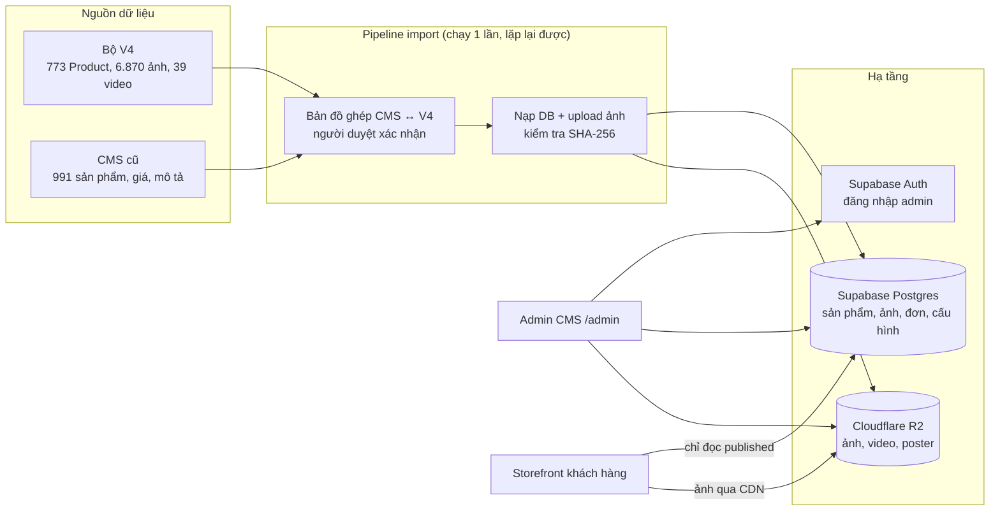

# Master Document: Catalog V4 Migration — Supabase Database + Cloudflare R2 Media Storage

## Metadata
- **Feature ID**: clonewatches-saas-3
- **Branch Name** (đề xuất, chưa tạo): feature/clonewatches-saas-3_supabase-r2-catalog-v4
- **File Naming Convention**: clonewatches-saas-3_master_261121_v1.11.21.md
- **Created Date**: 2026-11-19 15:15
- **Last Updated**: 2026-11-21 14:15
- **Current Version**: v1.11.21
- **Author**: @Antigravity-PM-Lead
- **Status**: Approved (người dùng duyệt 2026-11-21 14:31)
- **Approved By**: @user (2026-11-21)
- **Supersedes (một phần)**: `clonewatches-saas-2_master_261009_v1.0.0.md` — quyết định "FE-only, Google Sheets là SSoT, không database" được thay bằng Supabase + R2 (xem §10 Decision Log)

> [!NOTE]
> Mọi con số trong tài liệu được đo từ máy ngày 2026-11-19 (bộ V4 và repo hiện tại), trừ hạn mức gói dịch vụ lấy từ web — mục §9 ghi rõ phần phải xác minh lại trên trang giá chính thức trước khi ký duyệt.

---

## 1. Feature Overview

### Problem Statement
Website CloneWatches hiện không có nơi lưu trữ dữ liệu đáng tin cậy:

| Vấn đề | Hiện trạng (đã kiểm chứng trong repo) | Hậu quả kinh doanh |
|---|---|---|
| Catalog nằm trong bundle | `src/data/crawled_watches.json` — 991 sản phẩm, ~12,9 MB, nạp ngay khi mở web | Trang tải nặng, mỗi lần đổi giá/ảnh phải build và deploy lại |
| Chỉnh sửa Admin chỉ ở trình duyệt | `StoreContext` lưu `cw_products_catalog` trong `localStorage`; code đã có cảnh báo "quota exceeded" | Đổi máy hoặc xóa cache là mất dữ liệu; khách hàng không thấy thay đổi của admin |
| Google Sheets là SSoT (kế hoạch cũ) | Sheet công khai, bảng phẳng, không phân quyền, không ghi an toàn từ trình duyệt | Không biểu diễn được Product → nhiều ảnh → video; ai có link cũng đọc được |
| Ảnh không có kho riêng | CMS dùng URL ngoài: 488 ảnh `cdn.moncontentcdn.com` (nguồn crawl) và 967 ảnh `images.unsplash.com` (placeholder) | Phụ thuộc site bên thứ ba có thể xóa ảnh; ảnh placeholder không phải hàng thật |
| Admin chỉ có PIN phía client | `AdminDashboard.jsx` kiểm tra PIN trong trình duyệt | Không có kiểm soát truy cập thật ở server |
| Đơn hàng chỉ ở `localStorage` | Đơn gửi qua WhatsApp, không lưu server | Không có lịch sử đơn, không đối soát được |

Đồng thời đã có **bộ ảnh chính V4** (`WEB_DELIVERY_ALL_ASSIGNED_2026-11-16_NICKNAMES_V4`) với chất lượng cao hơn hẳn nhưng chưa có chỗ để đưa lên.

### Business Context
- Đây là catalog bán hàng chính: chất lượng ảnh và dữ liệu sản phẩm quyết định tỷ lệ chuyển đổi sang đơn WhatsApp.
- Bộ V4 là tài sản đã được duyệt: mỗi Product có tối thiểu 4 ảnh khác nhau, có nickname (tên gọi sưu tầm) cho 128 Product, và video QC cho 39 Product.
- Khách hàng (chủ shop) cần tự quản lý nội dung mà không phụ thuộc lập trình viên.
- Chi phí hạ tầng phải gần bằng 0 ở giai đoạn đầu, nhưng không được "nghẽn" khi lượng truy cập tăng.

### Goals & Objectives
1. **Một nguồn dữ liệu thật (SSoT) trên Supabase Postgres** cho sản phẩm, ảnh, video, đơn hàng và cấu hình.
2. **Toàn bộ ảnh/video V4 nằm trên Cloudflare R2**, phục vụ qua CDN, không tính phí băng thông.
3. **Admin CMS ghi/đọc trực tiếp DB**, đăng nhập thật (Supabase Auth), thay thế PIN phía client và `localStorage` làm kho dữ liệu.
4. **Import V4 lossless**: không mất dữ liệu nào của V4 (ID, nickname, thứ tự ảnh, video, trạng thái), không mất giá/mô tả/datasheet hiện có của CMS.
5. **Storefront chỉ hiển thị sản phẩm đã `published`**; V4 mặc định nạp vào ở trạng thái `unpublished` để chủ shop duyệt rồi bật.
6. **Giữ chi phí hạ tầng ở mức tối thiểu**, có ngưỡng cảnh báo trước khi phải trả phí.

---

## 2. Scope

### In-Scope
- Thiết kế schema Supabase: `products`, `product_images`, `product_videos`, `product_aliases`, `product_skus`, `orders`, `order_items`, `settings`, `import_batches`.
- Chính sách bảo mật hàng (RLS): khách chỉ đọc bản ghi `published`; chỉ admin đã đăng nhập mới được ghi.
- Bucket Cloudflare R2 cho ảnh/video, giữ nguyên cấu trúc đường dẫn V4 `assets/<product_id>/<file>`.
- Pipeline import V4 → Supabase + R2, kiểm tra bằng SHA-256 từ `asset_manifest.json`, chạy lại nhiều lần không tạo trùng (idempotent).
- Bản đồ ghép (mapping) 991 sản phẩm CMS cũ ↔ 773 Product V4 để giữ giá, mô tả, datasheet; file đối chiếu để người duyệt xác nhận. **Giá khớp từ CMS hiện tại là giá nháp** cho tới khi admin duyệt (BR-16–18).
- Quản lý giá Product V4: nhập tay, khớp từ CMS, trạng thái `draft`/`confirmed`, nguồn và lịch sử giá.
- Ẩn tạm sản phẩm CMS cũ ngoài V4 (`legacy`, BR-11).
- Nâng cấp Admin CMS: đăng nhập thật, CRUD sản phẩm trên DB, quản lý ảnh/video/nickname, bật/tắt xuất bản, import/export CSV.
- Storefront đọc catalog từ Supabase có cache (thay cho JSON trong bundle); fallback snapshot khi DB lỗi.
- Lưu đơn hàng (vẫn gửi WhatsApp như hiện tại) để có lịch sử.
- Sao lưu và khôi phục dữ liệu; theo dõi dung lượng/hạn mức.

### Out-of-Scope
- Thanh toán trực tuyến thật (giữ mock hiện tại).
- Đổi giao diện Storefront ngoài những chỗ bắt buộc để hiển thị ảnh/nickname/video mới.
- Xác nhận reference chính hãng hoặc tính xác thực của sản phẩm: V4 ghi rõ nickname chỉ mô tả kiểu dáng, **không** chứng nhận reference hay tính chính hãng — website phải giữ nguyên tinh thần này, không tự suy diễn từ nickname.
- Cào thêm dữ liệu từ nguồn ngoài. **Riêng crawl giá tự động:** nguồn do người dùng cung cấp sau (D9), chưa nằm trong đợt đầu; khi có nguồn sẽ mở rộng theo BR-16–19.
- Xử lý 1.077 Product nằm ngoài gói V4 (`review/products_not_in_delivery.csv`) — chỉ lưu danh sách tham chiếu.
- Hệ thống đa ngôn ngữ, đa tiền tệ động (giữ như hiện tại).

---

## 3. Key Personas (Summary)

### Primary Users
- **Chủ shop / Admin nội dung** (không rành kỹ thuật): nhập hàng, sửa giá, bật/tắt hiển thị, kiểm tra ảnh. Cần giao diện đơn giản, không mất việc khi đổi máy.
- **Khách mua hàng**: xem ảnh, video, thông số, nickname; chat WhatsApp để chốt đơn. Cần trang tải nhanh, ảnh đúng sản phẩm.

### Secondary Users
- **Lập trình viên / DevOps**: vận hành import, backup, theo dõi hạn mức, xử lý sự cố.
- **Người duyệt dữ liệu (reviewer)**: xác nhận bản đồ ghép CMS ↔ V4 và nickname trước khi xuất bản.

---

## 4. Current-State Findings (kết quả đối chiếu V4 ↔ CMS, đo ngày 2026-11-19)

### 4.1 Bộ V4
| Mục | Số đo |
|---|---|
| Product | 773 (`catalog.json`), 773 thư mục `assets/` — khớp 100% |
| Ảnh (.webp trong `images.csv`) | 6.870 dòng; 0 file thiếu trên đĩa |
| Tổng .webp trên đĩa | 6.909 (chênh 39 so với `images.csv`, trùng khớp 39 video — ghi nhận là poster video, **cần xác minh bằng import**) |
| Video | 39 MP4 kèm poster |
| Số ảnh mỗi Product | Tối thiểu 4 (không Product nào dưới 4) |
| Nickname | 128 Product |
| Trạng thái | 100% `unpublished` |
| Dung lượng thư mục `assets` | ~1.223 MB (≈ 1,2 GB) |
| `reference` | **Trống ở cả 773 Product** |
| Brand trống | 15 Product |
| Brand: Rolex / AP / Richard Mille / Omega / Patek / IWC | 286 / 132 / 133 / 103 / 58 / 38 |
| Brand khác | Hublot 5, Franck Muller 1, Vacheron Constantin 1, Tudor 1 |

### 4.2 CMS hiện tại
| Mục | Số đo |
|---|---|
| Sản phẩm | 991, tất cả `ACTIVE` |
| Khóa | `id` dạng slug, `spu` dạng `SPU-1003`; **không có** `product_id` kiểu `P000001` |
| Brand | Rolex 419; Patek 60; AP 60; Richard Mille 60; Omega 60; Panerai 60; Breitling 60; Hublot 60; Cartier 60; Vacheron 56; IWC 28; Franck Muller 8 |
| Ảnh | 488 URL CDN nguồn crawl + 967 URL Unsplash placeholder; **0 ảnh cục bộ** |
| Dữ liệu chỉ CMS có | Giá 2 variant (ví dụ 700 / 1.199 USD), mô tả HTML, datasheet, movement, kích thước, link Vimeo QC |

### 4.3 Mức khớp V4 ↔ CMS
| Tiêu chí | Kết quả |
|---|---|
| Khớp theo ID | 0% (không có khóa chung) |
| Khớp theo reference | 0% (V4 không có ref) |
| Khớp title chính xác | 0 / 773 |
| Khớp brand + collection | 347 / 773 (≈ 45%) |
| Khớp gần đúng brand + collection + model | 351 / 773 (≈ 45%); chỉ trỏ tới 26 / 991 sản phẩm CMS |
| Một phần | 38 / 773 |

### 4.4 Kết luận nghiệp vụ
1. **V4 là catalog khác, không phải bản cập nhật của CMS.** Không thể ghi đè 1-1.
2. **V4 không có giá, mô tả, datasheet, variant.** Import ghi đè sẽ làm mất toàn bộ phần này.
3. Brand lệch: CMS có Panerai, Breitling, Cartier (mỗi hãng 60) mà V4 không có; V4 có Tudor và 15 Product chưa rõ brand.
4. **Ảnh V4 thay thế gần như toàn bộ ảnh CMS** — hầu hết ảnh CMS hiện tại là placeholder.

---

## 5. Business Rules (quy tắc nghiệp vụ bắt buộc)

| # | Quy tắc |
|---|---|
| BR-01 | Khóa chính của Product là `product_id` (text, ví dụ `P000001`). ID, SKU và reference luôn xử lý như **chuỗi văn bản**. |
| BR-02 | Nhiều Product có thể trùng `reference` hoặc `nickname`; vẫn import **riêng từng Product** theo `product_id`, giữ nguyên bộ ảnh riêng. |
| BR-03 | Thứ tự ảnh theo `position` trong V4 là thứ tự gallery; ảnh `role=front` ở vị trí 1 là ảnh đại diện (`hero_image`). |
| BR-04 | Poster video **không tính** là ảnh sản phẩm và không được đếm vào điều kiện "tối thiểu 4 ảnh". |
| BR-05 | Bản ghi V4 nạp vào ở `publication_status = unpublished`. Chỉ admin chuyển sang `published`. |
| BR-06 | Điều kiện được xuất bản: có giá hợp lệ, có ≥ 4 ảnh V4, `export_status = export_ready`, brand không trống. |
| BR-07 | Product có `export_status` khác `export_ready` (`held_for_review`, `insufficient_media`) không được bật xuất bản. |
| BR-08 | `nickname` là nhãn mô tả: hiển thị cạnh title, **không** dùng để khẳng định reference hay tính chính hãng; để trống khi chưa có bằng chứng. |
| BR-09 | Bằng chứng nickname (`review/nickname_evidence.csv`) được lưu cùng DB để truy vết, chỉ admin xem được. |
| BR-10 | Giá và mô tả của CMS cũ được **tự động ghép và gắn** vào Product V4 khi điểm tin cậy đạt ngưỡng (người dùng chọn tự động duyệt và nối, 2026-11-21; ngưỡng cụ thể định ở Engineering Doc). Mọi cặp tự động gắn đều được đánh dấu `auto_matched` kèm điểm tin cậy để **admin rà soát và chỉnh sau**. Khi điểm tin cậy thấp hoặc một Product V4 khớp nhiều sản phẩm CMS có giá khác nhau, hệ thống **không đoán**: để trống giá và gắn cờ cho admin nhập. |
| BR-11 | Sản phẩm CMS cũ không ghép được với V4 (gồm toàn bộ Panerai, Breitling, Cartier và các sản phẩm khác ngoài V4) được **tạm ẩn**: giữ trong DB với `legacy = true` và `publication_status = unpublished`, **không xóa**, không hiển thị trên Storefront. Việc bật lại hay xóa vĩnh viễn là quyết định riêng về sau của chủ shop. |
| BR-16 | **Giá Product V4 có ba nguồn theo thứ tự ưu tiên:** (1) giá admin nhập tay; (2) giá khớp từ dữ liệu CMS hiện tại qua bản đồ ghép đã duyệt (BR-10); (3) giá từ crawl tự động (chỉ khi nguồn crawl được cung cấp, xem D9). Giá admin nhập luôn thắng và **không bị crawl ghi đè**. |
| BR-17 | Trạng thái giá (`price_status`): `auto_matched` (giá tự khớp từ CMS), `crawled` (giá crawl, khi có), `confirmed` (admin nhập hoặc đã rà soát). Giá `auto_matched` **đủ điều kiện hiển thị** theo BR-06, nhưng Product vẫn mặc định `unpublished` (BR-05) nên **admin luôn là người bật xuất bản**, và có bộ lọc "giá chưa rà soát" để chỉnh hàng loạt. Giá `crawled` chưa rà soát **không** tự đủ điều kiện xuất bản. |
| BR-18 | Mỗi giá lưu kèm **nguồn** (`admin` / `cms_legacy` / `crawl`), thời điểm và (với crawl) mã lô để truy vết và hoàn tác (BR-13). |
| BR-19 | Khi giá crawl khác giá đã `confirmed`, hệ thống chỉ **đánh dấu cảnh báo chênh lệch** cho admin xem, không tự đổi giá đang bán. |
| BR-12 | Ảnh Unsplash placeholder không được hiển thị trên Storefront sau khi chuyển sang V4. |
| BR-13 | Mọi thay đổi dữ liệu từ Admin ghi nhận người sửa và thời điểm (audit). |
| BR-14 | Khách chưa đăng nhập chỉ **đọc** bản ghi `published`; không đọc `orders`, `settings`, bằng chứng nickname hay dữ liệu nội bộ. |
| BR-15 | Khóa bí mật (`service_role`, khóa R2) không bao giờ có trong code frontend hay repo. |

---

## 6. Target Architecture (mức business)

**Phân vai hai hệ thống**

| Hệ thống | Lưu gì | Vì sao |
|---|---|---|
| Supabase (Postgres + Auth) | Dữ liệu có cấu trúc: sản phẩm, đường dẫn ảnh/video, đơn hàng, cấu hình, tài khoản admin | Quan hệ 1-nhiều, phân quyền theo hàng, truy vấn lọc theo brand/trạng thái |
| Cloudflare R2 | Tệp nhị phân: `.webp`, `.mp4`, poster | Không tính phí băng thông tải xuống; dung lượng miễn phí lớn hơn nhiều |

DB chỉ lưu **đường dẫn tương đối** (`assets/P000001/P000001-front-01.webp`); tên miền CDN nằm ở cấu hình để đổi nhà cung cấp mà không sửa dữ liệu.

---

## 7. Data Model (khái niệm — chi tiết SQL ở Engineering Doc)

| Thực thể | Trường chính | Nguồn |
|---|---|---|
| `products` | `product_id` (PK), `family_id`, `brand`, `collection`, `model`, `reference`, `title`, `nickname`, `dial_color`, `case_finish`, `bracelet_or_strap`, `size_mm`, `case_material`, `media_readiness`, `export_status`, `publication_status`, `hero_image_path`, `legacy_cms_id`, `spu`, `price_variant_1`, `price_variant_2`, `stock_status`, `description_html`, `datasheet` | V4 + CMS cũ (sau khi ghép) |
| `product_images` | `image_id` (PK), `product_id` (FK), `role`, `position`, `storage_path`, `width`, `height`, `sha256` | `images.csv`, `asset_manifest.json` |
| `product_videos` | `video_id` (PK), `product_id` (FK), `mp4_path`, `poster_path`, `width`, `height`, `duration_s` | `videos.csv` |
| `product_skus`, `product_aliases` | SKU gốc và alias liên quan | `skus.csv`, `product_aliases.json` |
| `nickname_evidence` | `product_id`, `basis` (`named_design` / `visual_style` / trống), bằng chứng, phiên bản review | `review/nickname_*.csv` |
| `orders`, `order_items` | Khách, sản phẩm, giá tại thời điểm đặt, trạng thái, kênh WhatsApp | Storefront |
| `settings` | Số WhatsApp, thông báo, cấu hình hiển thị | Admin |
| `import_batches` | Mã lô, nguồn, số bản ghi, kết quả kiểm tra, người chạy | Pipeline |

---

## 8. Success Metrics (KPIs) & Acceptance

| KPI | Mục tiêu | Cách đo |
|---|---|---|
| Toàn vẹn dữ liệu V4 | 773 Product, 6.870 ảnh, 39 video trong DB — 100% khớp `catalog.json`/`images.csv`/`videos.csv` | Script đối soát số lượng + ID |
| Toàn vẹn tệp | 100% tệp trên R2 khớp SHA-256 trong `asset_manifest.json` | Script kiểm hash sau upload |
| Không mất dữ liệu cũ | 100% sản phẩm CMS cũ còn trong DB (ghép hoặc `legacy`) | Đếm 991 trước/sau |
| Ghép CMS ↔ V4 | Báo cáo thống kê sau import: số cặp tự nối (`auto_matched`), số cặp để trống do mơ hồ/điểm thấp, số Product chưa có giá. Admin rà soát được qua bộ lọc "giá chưa rà soát". Tham chiếu hiện tại ≈ 45% khớp theo tên | Thống kê từ `import_batches` + mẫu kiểm tra thủ công |
| Product publish được | Mọi Product `published` đều đạt BR-06 | Truy vấn kiểm tra |
| Hiệu năng trang | Tải trang catalog nhanh hơn hiện tại; dữ liệu không còn nằm trong bundle (bundle giảm ≈ 12,9 MB) | Đo trước/sau bằng `vite build` và Lighthouse |
| Bảo mật | Khách ẩn danh không đọc được `orders`/`settings`; không ghi được bất kỳ bảng nào | Test RLS thật |
| Admin | Sửa giá trên máy A, thấy ngay trên máy B | Kiểm thử luồng thật |
| Chi phí | Chi phí hạ tầng tháng đầu theo ngân sách §9 | Hóa đơn nhà cung cấp |
| Phục hồi | Khôi phục DB từ bản sao lưu thành công | Diễn tập 1 lần trước go-live |

---

## 9. Cost, Limits & Risks

### 9.1 Hạn mức gói miễn phí (lấy từ tìm kiếm web ngày 2026-11-19 — **phải xác minh lại trên trang giá chính thức trước khi duyệt**)

| | Supabase Free | Cloudflare R2 Free |
|---|---|---|
| Lưu trữ | 1 GB | 10 GB mỗi tháng |
| Giới hạn một file | 50 MB | không nêu trong nguồn |
| Băng thông tải xuống | 5 GB mỗi tháng | Miễn phí |
| Thao tác | không nêu | 1 triệu ghi + 10 triệu đọc mỗi tháng |
| Vượt hạn mức | Nâng gói Pro | \$0,015 / GB / tháng |

### 9.2 Tác động lên dự án
- V4 ≈ 1,2 GB → **vượt** Supabase Free storage, **không vượt** R2 Free (≈ 12% của 10 GB). Vì vậy ảnh/video đi R2, DB chỉ chứa văn bản (vài MB).
- Băng thông ảnh qua R2 không tốn phí; băng thông Supabase chỉ phục vụ dữ liệu văn bản/JSON.

### 9.3 Rủi ro & biện pháp

| # | Rủi ro | Mức | Biện pháp |
|---|---|---|---|
| R1 | Supabase Free tự tạm dừng project khi lâu không hoạt động (chính sách hiện hành cần xác minh) — website ít truy cập có thể bị ảnh hưởng | Cao | Lịch ping định kỳ hoặc nâng gói Pro khi go-live; fallback snapshot cho Storefront |
| R2 | Ghép CMS ↔ V4 sai, gắn nhầm giá cho nhầm đồng hồ (rủi ro tăng vì đã chọn tự động nối, BR-10) | Cao | Ngưỡng tin cậy cao; khớp mơ hồ thì để trống giá; lưu `auto_matched` + điểm tin cậy; bộ lọc rà soát cho admin; V4 mặc định `unpublished` nên không lên Storefront cho tới khi admin bật; báo cáo thống kê số cặp tự nối và số cặp để trống sau import |
| R3 | Mất giá/mô tả cũ khi import | Cao | Import không ghi đè; giữ nguyên bản sao `crawled_watches.json` + `clonewatches_master_catalog.csv` trước khi bắt đầu |
| R4 | V4 không có `reference`, nên dễ hiểu nhầm nickname là xác nhận chính hãng | Trung bình | BR-08 + dòng cảnh báo trong Admin |
| R5 | Lộ khóa bí mật | Cao | BR-15; khóa chỉ ở biến môi trường server/Vercel; kiểm tra secret trước commit |
| R6 | Nguồn ảnh cũ (CDN crawl) biến mất | Trung bình | Thay toàn bộ bằng ảnh V4 trên R2 |
| R7 | Rủi ro bản quyền/thương hiệu của ảnh và tên thương hiệu | Cần chủ shop quyết định | Ngoài phạm vi kỹ thuật; ghi nhận để chủ shop xác nhận trước khi xuất bản |
| R8 | Poster 39 file lệch đếm ảnh | Thấp | Kiểm tra bằng import đối soát (BR-04) |
| R9 | 15 Product V4 trống brand | Trung bình | Admin điền brand trước khi xuất bản (BR-06) |
| R10 | Một nhà cung cấp gặp sự cố | Trung bình | Snapshot JSON dự phòng; bản sao lưu DB định kỳ |

---

## 10. Decision Log

| # | Quyết định | Lý do | Trạng thái |
|---|---|---|---|
| D1 | Supabase Postgres làm SSoT dữ liệu | Quan hệ 1-nhiều, RLS, Auth, cùng dữ liệu cho Admin và Storefront | **Đã chốt (2026-11-21)** |
| D2 | Cloudflare R2 chứa ảnh/video | 1,2 GB vượt Supabase Free; R2 không tính phí egress | **Đã chốt (2026-11-21)** |
| D3 | Thay thế chỉ đạo cũ "Google Sheets là SSoT, không database" của `clonewatches-saas-2` | Sheets không biểu diễn được cấu trúc V4 và không phân quyền | **Đã chốt: bỏ Google Sheets (2026-11-21)** |
| D4 | Bỏ hẳn Google Sheets khỏi luồng dữ liệu; chỉ còn export/import CSV trong Admin | Tránh 2 nguồn dữ liệu mâu thuẫn | **Đã chốt** |
| D5 | V4 nạp ở `unpublished` | Phù hợp trạng thái trong V4, chủ shop duyệt từng đợt | Đề xuất |
| D6 | Dùng gói **Free** của Supabase và R2 | Người dùng chọn (2026-11-21); chấp nhận rủi ro R1 (project có thể tự tạm dừng) | **Đã chốt** |
| D7 | Giá Product V4 do **admin nhập tay và/hoặc crawl tự động**; crawl chỉ điền giá **nháp**, admin duyệt trước khi xuất bản | Người dùng chốt hướng; nguồn crawl cụ thể chưa xác định | **Đã chốt hướng, nguồn crawl chưa rõ** |
| D8 | **Tận dụng CMS cũ ở phần văn bản** (giá 2 variant, mô tả HTML, datasheet, movement, kích thước, link QC) qua bản đồ ghép được duyệt; không tận dụng ảnh (placeholder) | Người dùng hỏi và đồng ý hướng tận dụng | **Đã chốt hướng; mapping cần duyệt (BR-10)** |

| D9 | **Nguồn crawl giá do người dùng cung cấp sau**; trong lúc chờ, giá V4 lấy từ **dữ liệu CMS hiện tại** qua bản đồ ghép (BR-16, BR-17) và từ admin nhập tay | Người dùng chốt 2026-11-21. Phần crawl nằm ngoài phạm vi đợt đầu, mở lại khi có nguồn | **Đã chốt** |
| D10 | Sản phẩm CMS cũ ngoài V4 **tạm ẩn** (BR-11) | Người dùng chốt 2026-11-21 | **Đã chốt** |
| D11 | **Khớp giá/dữ liệu CMS sang V4 tự động duyệt và nối**, admin điều chỉnh sau (sửa BR-10, BR-17, R2) | Người dùng chốt 2026-11-21. Giảm công duyệt thủ công 773 Product; rủi ro nhầm giá được chặn bằng ngưỡng, không đoán khi mơ hồ, và V4 mặc định `unpublished` | **Đã chốt** |
| D12 | **Master Doc được duyệt** | Người dùng duyệt 2026-11-21 14:31 | **Approved** |

### 10.1 Hạ tầng đã tạo (thông tin không bí mật, xác nhận ngày 2026-11-21)
| Hạng mục | Giá trị |
|---|---|
| Supabase project URL | `https://nuhgccxcwlrsbbcxpskn.supabase.co` — dự án **hoàn toàn trống** (chưa có bảng), gói Free |
| Supabase khóa | Dùng khóa **publishable** (frontend) và **secret** (chỉ server/script). Khóa ký JWT của dự án đã là ECC P-256 |
| R2 bucket | `watch-saas-media`, đã bật public URL, bucket đang trống |
| R2 CORS | Đã cấu hình cho `localhost` **và đã thêm domain Vercel** (người dùng xác nhận 2026-11-21). Chưa kiểm thử từ trình duyệt vì bucket còn trống; sẽ kiểm bằng ảnh đầu tiên sau khi upload |
| Domain production hiện tại | `https://product-prototype-pi.vercel.app` |
| Lưu khóa bí mật | `.env.local` trên máy (đã bị `.gitignore` chặn, kiểm tra 2026-11-21); production đặt trong biến môi trường Vercel. **Không** ghi giá trị khóa vào tài liệu |
| Kiểm tra kết nối (chỉ đọc, 2026-11-21) | R2 liệt kê bucket 200 OK; Supabase publishable và secret đều hợp lệ |

---

## 11. High-Level Timeline

| Phase | Nội dung | Điều kiện hoàn thành |
|---|---|---|
| **Phase 0** | Hoàn tất bộ tài liệu: Master → Product → Engineering → QA → Tasks; duyệt các quyết định mở §13 | Master được ký duyệt |
| **Phase 1** | Dựng Supabase project + R2 bucket, schema, RLS, môi trường; kiểm thử RLS | Test RLS đạt |
| **Phase 2** | Pipeline import V4 + upload R2 + đối soát SHA-256 | 100% khớp §8 |
| **Phase 3** | Bản đồ ghép CMS ↔ V4, người duyệt xác nhận, gắn giá/mô tả | Có chữ ký duyệt mapping |
| **Phase 4** | Admin CMS nối DB (đăng nhập thật, CRUD, ảnh, nickname, xuất bản) | Luồng admin đạt kiểm thử thật |
| **Phase 5** | Storefront đọc từ DB + CDN, fallback snapshot, lưu đơn | Build và kiểm thử trình duyệt đạt |
| **Phase 6** | QA toàn diện, diễn tập backup, go-live theo đợt publish | Báo cáo QA đạt |

Không ghi mốc ngày cụ thể trong bản Draft; sẽ chốt ở Tasks Doc sau khi duyệt phạm vi.

---

## 12. Stakeholders & Responsibilities
- **Product / Chủ shop**: @user — duyệt phạm vi, mapping, xuất bản, quyết định bản quyền
- **Design**: @TBD
- **Development**: @Antigravity-PM-Lead (điều phối), executor do harness phân vai
- **QA**: @TBD (phải khác người code theo `ROLES.json`)
- **Project Manager**: @Antigravity-PM-Lead

---

## 13. Open Questions

**Đã trả lời (2026-11-21):** bỏ Google Sheets (D3/D4) · đã có Supabase + R2 (§10.1) · giữ gói Free (D6) · giá do admin nhập, khớp từ CMS hiện tại, hoặc crawl sau (D7/D9, BR-16–19) · CMS cũ ngoài V4 tạm ẩn (D10, BR-11) · đã thêm domain Vercel vào R2 CORS.

**Còn mở:**
1. **Nguồn crawl giá** (người dùng sẽ cung cấp sau, D9): website nào, tần suất, được phép crawl không, và quy tắc ghép sản phẩm crawl với Product V4 (V4 không có `reference`). Phần crawl chưa vào phạm vi đợt đầu cho tới khi có nguồn.
2. **Ngưỡng và thuật toán khớp tự động** (D11): chốt cụ thể ở Engineering Doc (trường dùng để khớp: brand, collection, model, màu mặt số, kích thước; ngưỡng điểm tin cậy). Chốt trước khi chạy import, và thống kê kết quả để người dùng xem.
3. **Phương án khi Supabase Free tạm dừng** (R1): chấp nhận ping định kỳ, hay chuẩn bị nâng gói khi go-live?
4. **Domain riêng cho media** (thay link `r2.dev`) khi chạy thật: có/chưa?
5. **GitHub issue/ticket** chính thức (tên file đang dùng số `3` nối tiếp `clonewatches-saas-2`).
6. **Bản quyền/thương hiệu ảnh và tên thương hiệu** (R7): chủ shop xác nhận trước khi xuất bản.
7. ~~Duyệt chính thức Master Doc~~ — **đã duyệt 2026-11-21 (D12)**.

---

## 14. Related Documents
- **Product Doc**: `01-product/clonewatches-saas-3_product_261121_v1.11.21.md` — _Approved (2026-11-21)_
- **Engineering Doc**: `02-engineering/clonewatches-saas-3_engineering_261121_v1.11.21.md` — _Approved (2026-11-21)_
- **QA Doc**: `03-qa/clonewatches-saas-3_qa_261121_v1.11.21.md` — _Approved (2026-11-21)_
- **Tasks Doc**: `04-tasks/clonewatches-saas-3_tasks_261121_v1.11.21.md` — _Approved (2026-11-21)_
- **Doc liên quan (bị thay thế một phần)**: `00-master/clonewatches-saas-2_master_261009_v1.0.0.md`
- **Dữ liệu nguồn V4**: `C:\Users\AD\Downloads\WEB_DELIVERY_ALL_ASSIGNED_2026-11-16_NICKNAMES_V4` (`README.md`, `documentation/SCHEMA.md`, `review/validation.json`)
- **GitHub Issue / PR**: _chưa có_

---

## 15. Changelog

| Version | Date | Time (HH:mm) | Author | Description | Reviewed By | Status |
|---------|------|--------------|--------|-------------|-------------|--------|
| v1.11.21 | 2026-11-21 | 14:35 | @Antigravity-PM-Lead | **Master Doc được người dùng duyệt (Approved).** Chốt D11: khớp CMS → V4 tự động duyệt và nối, admin chỉnh sau; sửa BR-10, BR-17, R2, KPI ghép; thêm `price_status` | @user | Approved |
| v1.11.21 | 2026-11-21 | 14:30 | @Antigravity-PM-Lead | Bổ sung theo người dùng: CORS đã thêm domain Vercel; crawl giá hoãn tới khi có nguồn (D9); CMS cũ ngoài V4 tạm ẩn (D10, BR-11); thêm BR-16–19 về giá nháp/nguồn giá/không ghi đè; cập nhật scope và câu hỏi mở | — | Review |
| v1.11.21 | 2026-11-21 | 14:15 | @Antigravity-PM-Lead | Chốt D1–D4, D6–D8 theo trả lời người dùng; thêm §10.1 hạ tầng đã tạo (Supabase, R2, Vercel domain); cập nhật câu hỏi mở; đổi tên file theo quy ước version | — | Review |
| v1.0.0 | 2026-11-19 | 15:15 | @Antigravity-PM-Lead | Bản nháp đầu: nghiệp vụ, số đo hiện trạng V4 ↔ CMS, quy tắc nghiệp vụ, kiến trúc Supabase + Cloudflare R2, rủi ro, câu hỏi mở | — | Draft |

---

## 16. Approval & Sign-off
- [x] **Product Lead**: @user — Date: 2026-11-21
- [ ] **Tech Lead**: @TBD — Date: ____ _(người dùng đã duyệt thay cho các vai chưa có người; ghi nhận để bổ sung khi có Tech/QA Lead)_
- [ ] **QA Lead**: @TBD — Date: ____
- [x] **Project Manager**: @Antigravity-PM-Lead — Date: 2026-11-21

> [!IMPORTANT]
> Theo luồng harness: Master Doc phải được duyệt trước khi tạo Product, Engineering, QA và Tasks Doc. Chưa có dòng code hay thay đổi hạ tầng nào được thực hiện.

---

## 17. Notes & Assumptions
- Bộ V4 và repo được đọc trực tiếp từ máy ngày 2026-11-19; không có thay đổi nào ghi vào thư mục V4.
- Chưa tìm thấy dấu vết Supabase nào trong repo (không dependency, không `.env`, không SQL); nếu đã có project/bảng thật thì cần xuất dữ liệu để đối chiếu lại và cập nhật tài liệu này.
- Hạn mức gói dịch vụ có thể thay đổi; mọi con số ở §9.1 là tham chiếu.
- Tỷ lệ ghép ≈ 45% là ước lượng theo tên, không phải kết quả ghép đã duyệt.
