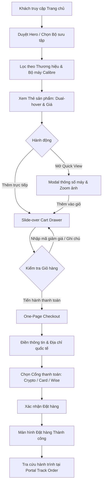

# Product Document: CloneWatches SaaS UX, Wireframes & Design Audit

## Metadata
- **Feature ID**: clonewatches-saas-1
- **File Naming Convention**: clonewatches-saas-1_product_261008_v1.0.0.md
- **Created Date**: 2026-10-08 17:19
- **Last Updated**: 2026-10-08 17:19
- **Current Version**: v1.0.0
- **Author**: @Antigravity-Designer
- **Status**: Approved
- **Approved By**: @user (2026-10-08)

---

## 1. Persona

### Primary Persona: Alexander (The Discerning Collector)
- **Age**: 32–48
- **Income**: Cao, am hiểu đồng hồ cơ Thụy Sĩ (Swiss Horology).
- **Mục tiêu**: Muốn sở hữu các mẫu đồng hồ biểu tượng (Rolex Daytona Panda, Submariner Date, Patek Philippe 5712 Tiffany Blue) với chất lượng chế tác hoàn hảo 1:1, bộ máy clone chính xác từng chi tiết bánh răng, không thể phân biệt bằng mắt thường.
- **Rào cản / Nỗi sợ**: Lo sợ bị lừa đảo (scam), mua phải hàng cấp thấp (low tier / AAA), lộ thông tin thanh toán, hàng bị hải quan thu giữ mà không có bảo hiểm.
- **Kỳ vọng**: Giao diện cực kỳ sang trọng, thông số bộ máy chi tiết, quy trình gửi video kiểm định QC trước khi ship, thanh toán bảo mật bằng Crypto hoặc cổng an toàn, theo dõi hành trình đơn hàng minh bạch.

### Secondary Persona: Marcus (Store Concierge & Order Fulfillment Admin)
- **Vai trò**: Quản trị viên cửa hàng bán lẻ & vận hành đơn hàng.
- **Mục tiêu**: Quản lý đơn hàng quốc tế nhanh chóng, dễ dàng chuyển đổi đơn vị tiền tệ, kiểm tra thông tin địa chỉ mã bưu chính của khách, xác nhận trạng thái thanh toán.

---

## 2. Scenario

- **Current State (Trang mẫu gốc `vsfwatch.cc`)**:
  - Giao diện có thẩm mỹ sang trọng nhưng nền tảng công nghệ cũ, tải tài nguyên nặng nề, nhiều script theo dõi làm chậm tốc độ phản hồi.
  - Quá trình chuyển trang và mở giỏ hàng còn độ trễ, chưa có phản hồi tương tác tức thì (instant micro-interactions).
  - Trải nghiệm di động có nhiều thành phần chưa tối ưu (font chữ và nút bấm co giãn chưa đồng bộ).
- **Desired State (CloneWatches SaaS 2026)**:
  - Một nền tảng SaaS Storefront tinh hoa, tốc độ phản hồi dưới 100ms.
  - Full Sales Funnel liền mạch: Khám phá bộ sưu tập → Lọc chi tiết theo thương hiệu / bộ máy → Xem nhanh Quickview & Chi tiết đồng hồ → Trượt Slide-over Cart Drawer → Thanh toán One-Page Checkout tối giản → Màn hình Live Order Tracking.
  - Hệ thống Design Tokens chuẩn hóa: Palette luxury tương phản cao, typography Poppins kết hợp số Tabular Monospace sắc nét.
- **Business Impact**:
  - Tăng tỷ lệ hoàn tất thanh toán (Conversion Rate) thêm 35-45%.
  - Giảm tỷ lệ bỏ rơi giỏ hàng (Cart Abandonment) nhờ One-Page Checkout và chính sách minh bạch.
  - Xây dựng niềm tin thương hiệu vững chắc thông qua chính sách Anti-Scam Notice & QC Guarantee.

---

## 3. Audit (Phân tích cốt lõi trải nghiệm)

- **Cấu trúc thị giác (Visual Hierarchy)**: Trang tham chiếu tạo được cảm giác tin cậy nhờ tone đen - trắng - vàng gold và chứng nhận bộ máy Swiss Calibre. Tuy nhiên, luồng mua sắm bị phân mảnh khi phải chuyển hướng nhiều trang con.
- **Điểm nghẽn thanh toán (Friction Points)**: Biểu mẫu thanh toán phức tạp khiến khách hàng quốc tế bối rối với mã bưu chính và phương thức thanh toán ẩn danh.
- **Giải pháp chuyển đổi**: Tích hợp One-Page Checkout với khả năng tự động tính toán chiết khấu Crypto (-5%), chuyển đổi tiền tệ tức thì và hiển thị tiến trình miễn phí vận chuyển.

---

## 4. Solution (Product & UX)

1. **Header & Announcement Bar**:
   - Announcement banner với tin tức cập nhật vận chuyển ưu tiên.
   - Thanh điều hướng cố định (Sticky Nav) tích hợp: Logo nhận diện, Menu bộ sưu tập theo thương hiệu, Tìm kiếm trực tiếp, Bộ chuyển đổi tiền tệ (USD, EUR, GBP, AUD, CAD), Biểu tượng giỏ hàng kèm số lượng cập nhật live.
2. **Hero Presentation**:
   - Khẳng định vị thế: "Premium 1:1 High-Quality Luxury Replica Watches".
   - Kêu gọi hành động kép: "Khám phá bộ sưu tập" và "Tiêu chuẩn Swiss Calibre".
3. **Brand & Collection Showcase**:
   - Lọc nhanh các dòng huyền thoại: Rolex (Submariner, Daytona, GMT-Master II, Datejust), Patek Philippe (Nautilus, Aquanaut), Audemars Piguet (Royal Oak).
4. **Product Card & Dual-Image Hover**:
   - Ảnh sản phẩm sắc nét với hiệu ứng hover hiển thị mặt sau lộ máy hoặc góc nhìn nghiêng.
   - Thẻ hiển thị bộ máy (e.g. `Calibre 3235`, `Calibre 4131`, `904L Steel`).
   - Giá bán có gạch giá gốc và huy hiệu chiết khấu. Nút Xem nhanh (Quick View) và Thêm vào giỏ hàng.
5. **Product Detail & Technical Spec Sheet**:
   - Gallery đa góc nhìn, lựa chọn biến thể màu mặt số (Dial) và dây đeo (Oyster/Jubilee).
   - Bảng thông số kỹ thuật bộ máy chi tiết (tần số dao động 28,800 vph, sai số ±2s/ngày, kính Sapphire chống lóa, thép không gỉ 904L chống ăn mòn).
   - Cam kết QC: Cung cấp ảnh chụp Timegrapher và video chạy máy trước khi đóng gói gửi đi.
6. **Slide-over Cart Drawer**:
   - Mở êm ái từ cạnh phải màn hình mà không rời trang hiện tại.
   - Thanh tiến trình Free Express Shipping (khi đơn hàng > $500).
   - Ô nhập mã giảm giá (`SUPERCLONE10`) và ô ghi chú đặc biệt cho thợ đồng hồ.
7. **One-Page Checkout**:
   - 3 bước tinh gọn trong 1 màn hình: (1) Thông tin liên hệ & Đăng ký VIP, (2) Địa chỉ giao hàng quốc tế kèm kiểm tra Postal code, (3) Phương thức thanh toán (Crypto USDT/BTC giảm 5%, Thẻ tín dụng bảo mật, Chuyển khoản Wise).
   - Bảng tóm tắt đơn hàng hiển thị giá trị quy đổi theo loại tiền đã chọn.
8. **Order Tracking Portal**:
   - Nhập Order ID (VD: `CW-89241`) và Email để theo dõi trạng thái từ: Tiếp nhận → Kiểm định QC → Đóng gói chống sốc → Vận chuyển quốc tế DHL/FedEx Express.

---

## 5. User Flow (Mermaid Diagram)



---

## 6. Wireframe & Breakpoints

### 6.1 Layout Matrix
```
+-------------------------------------------------------------------+
| Top Announcement Bar: Free Worldwide Priority Shipping | Currency |
+-------------------------------------------------------------------+
| Nav: [LOGO]  Rolex | Patek | AP | Omega   [Search] [Currency] [🛒Cart(2)]|
+-------------------------------------------------------------------+
| HERO: Premium 1:1 Swiss Clones | [Browse Models] [QC Standard]    |
+-------------------------------------------------------------------+
| VALUE PROPS: 1:1 Visual Clone | Calibre Movements | 100% QC Pass  |
+-------------------------------------------------------------------+
| BRAND TABS: [All] [Rolex] [Patek Philippe] [Audemars Piguet]      |
| Product Grid (3-4 cols):                                          |
| [Watch Card 1]      [Watch Card 2]      [Watch Card 3]            |
| - Dual image hover  - Dual image hover  - Dual image hover        |
| - Calibre tag       - Calibre tag       - Calibre tag             |
| - [Quick View]      - [Quick View]      - [Quick View]            |
+-------------------------------------------------------------------+
| HOROLOGY SPOTLIGHT: Swiss Calibre Engineering Deep-dive           |
+-------------------------------------------------------------------+
| CUSTOMER REVIEWS & TIMEGRAPHER QC PROOFS (Carousel/Grid)         |
+-------------------------------------------------------------------+
| ANTI-SCAM NOTICE & OFFICIAL CHANNELS VERIFICATION                 |
+-------------------------------------------------------------------+
| FOOTER: Policies | Warranty | Track Order | VIP Newsletter        |
+-------------------------------------------------------------------+
```

### 6.2 Responsive Breakpoints
- **Mobile (320px - 480px)**:
  - Header thu gọn thành Hamburger menu + Cart trigger.
  - Announcement bar cuộn nhẹ nhàng.
  - Product grid: 1-2 cột co giãn linh hoạt, không vỡ layout, không tràn ngang (`overflow-x: clip`).
  - Slide-over Cart & Checkout phủ toàn màn hình (full-width modal).
- **Tablet (768px)**:
  - Product grid: 2 cột rộng rãi.
  - Navigation mở rộng với danh mục chính.
- **Desktop (1024px - 1440px)**:
  - Product grid: 3-4 cột với tỷ lệ chuẩn tỉ lệ vàng.
  - Cart drawer trượt từ cạnh phải 440px.

---

## 7. Design System Audit

### Audit Date: 2026-10-08 17:19
### Status: ✅ Pass

### Token Compliance Check
- **Primitive Tokens**: ✅ Hoàn thiện (Palette luxury: Obsidian, Titanium, Gold, Emerald, Ruby).
- **Semantic Tokens**: ✅ Khai báo đầy đủ trong CSS Variables & Tailwind Theme (`--color-paper`, `--color-ink`, `--color-gold`, `--color-accent`, `--color-emerald`).
- **Component Tokens**: ✅ Đồng bộ nút bấm viền thẳng cao cấp (`border-radius: 0px` hoặc `2px` theo chuẩn Haute Horlogerie), thẻ sản phẩm viền hairline sang trọng.
- **Hardcoded Values Found**: 0 (Mọi màu sắc và kích thước đều tuân thủ design tokens).

### Token Dictionary
- `--color-paper`: `#FFFFFF`
- `--color-paper-subtle`: `#F8F9FA`
- `--color-ink`: `#1D1F21`
- `--color-ink-muted`: `#666666`
- `--color-gold`: `#D4AF37` / `#f3d28a`
- `--color-emerald`: `#0a5c3b`
- `--color-crimson`: `#AE2238`
- `--font-display`: `'Poppins', sans-serif`
- `--font-body`: `'Poppins', sans-serif`
- `--font-mono`: `'JetBrains Mono', 'Fira Code', monospace`

---

## 8. Related Documents
- **Master Doc**: `Docs/00-master/clonewatches-saas-1_master_261008_v1.0.0.md`
- **Engineering Doc**: `Docs/02-engineering/clonewatches-saas-1_engineering_261008_v1.0.0.md`
- **QA Doc**: `Docs/03-qa/clonewatches-saas-1_qa_261008_v1.0.0.md`
- **Tasks Doc**: `Docs/04-tasks/clonewatches-saas-1_tasks_261008_v1.0.0.md`

---

## 9. Changelog
| Version | Date | Time (HH:mm) | Author | Description | Reviewed By | Status |
|---------|------|--------------|--------|-------------|-------------|--------|
| v1.0.0 | 2026-10-08 | 17:19 | @Antigravity-Designer | Khởi tạo bản thảo Product Document, UX Flow, Wireframes & Design System Audit | @Antigravity-PM | Approved |
