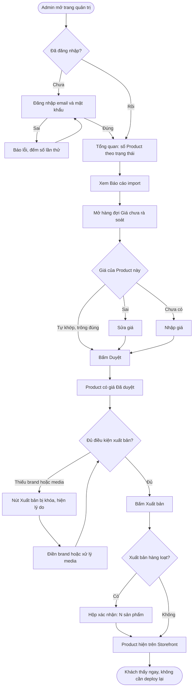
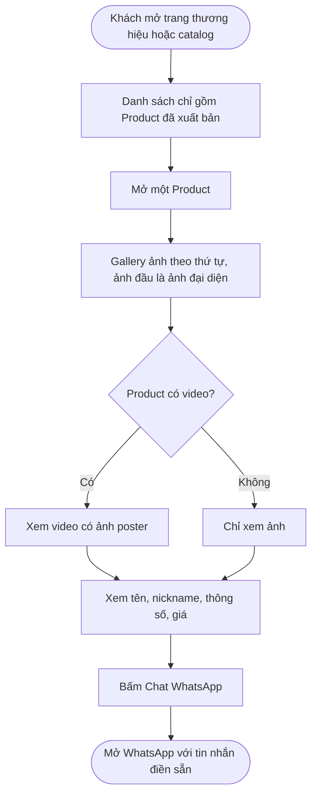
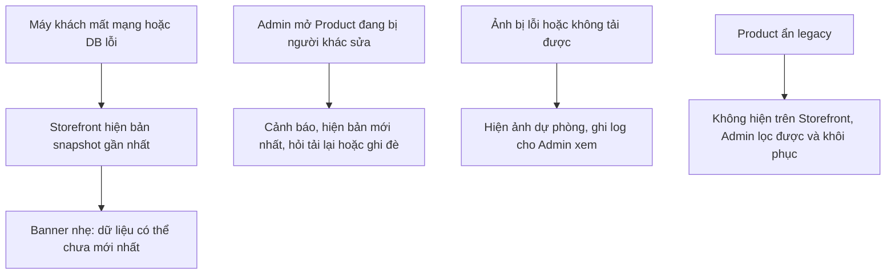

# Product Document: Catalog V4 — Admin CMS trên Supabase + Media trên Cloudflare R2

## Metadata
- **Feature ID**: clonewatches-saas-3
- **Branch Name** (đề xuất, chưa tạo): feature/clonewatches-saas-3_supabase-r2-catalog-v4
- **File Naming Convention**: clonewatches-saas-3_product_261121_v1.11.21.md
- **Created Date**: 2026-11-21 14:40
- **Last Updated**: 2026-11-21 14:40
- **Current Version**: v1.11.21
- **Author**: @Antigravity-Product-Designer
- **Status**: Approved (người dùng duyệt 2026-11-21 15:35)
- **Approved By**: @user (2026-11-21)
- **Master Doc (đã duyệt 2026-11-21)**: `00-master/clonewatches-saas-3_master_261121_v1.11.21.md`

> [!NOTE]
> Tài liệu này mô tả **sản phẩm và trải nghiệm** (ai dùng, làm gì, màn hình nào, luồng nào). Không liệt kê file code hay SQL — phần đó thuộc Engineering Doc. Mã quy tắc `BR-xx`, quyết định `Dxx` tham chiếu về Master Doc.

---

## 1. Persona

### Primary Users

**P1 — Chủ shop / Admin nội dung ("Lan")**
- Không rành kỹ thuật, làm việc chủ yếu trên **laptop**, thỉnh thoảng trên **điện thoại** (đã có tinh chỉnh mobile cho Admin).
- Cần: biết Product nào đã sẵn sàng bán, sửa giá nhanh, chọn ảnh đại diện, bật/tắt hiển thị.
- Nỗi đau hiện tại: sửa trên máy này, máy khác không thấy; sợ làm hỏng dữ liệu; 991 sản phẩm toàn ảnh placeholder.
- Động lực: lên 773 Product V4 đẹp, đúng ảnh, nhanh nhất có thể, mà không bán nhầm giá.

**P2 — Khách mua hàng ("Minh")**
- Xem trên điện thoại là chính, so sánh nhiều mẫu cùng dòng.
- Cần: ảnh đẹp, đủ góc, thấy video thật, tên gọi quen thuộc (nickname) để nhận ra mẫu, giá rõ, liên hệ WhatsApp nhanh.
- Nỗi đau hiện tại: ảnh placeholder, ít ảnh, không rõ đây là mẫu nào.

### Secondary Users

**P3 — Người rà soát dữ liệu (có thể chính là Lan)**: kiểm tra giá tự khớp từ CMS cũ, xác nhận hoặc sửa.

**P4 — Lập trình viên / vận hành**: chạy import, xem báo cáo lô, theo dõi hạn mức Free, khôi phục khi cần. Không dùng Admin giao diện thường ngày.

---

## 2. Scenario

### Current State
- Admin lưu chỉnh sửa trong trình duyệt; đổi máy hoặc xóa cache là mất, khách không thấy thay đổi.
- Catalog 991 sản phẩm nằm trong bundle, hầu hết dùng ảnh Unsplash placeholder; chỉ khoảng 23 sản phẩm có bộ ảnh thật từ CDN nguồn.
- Bộ ảnh chính V4 (773 Product, 6.870 ảnh, 39 video, 128 nickname) đã sẵn sàng nhưng chưa có nơi đưa lên và chưa có giá.
- Đăng nhập Admin chỉ bằng PIN trong trình duyệt.

### Desired State
- Dữ liệu sống trên server: Lan sửa ở máy nào, máy khác và Storefront thấy ngay.
- 773 Product V4 xuất hiện trong Admin ở trạng thái **chưa xuất bản**, kèm ảnh/video/nickname chuẩn; giá được **tự khớp từ CMS cũ** khi đủ tin cậy, chỗ nào mơ hồ thì **để trống và gắn cờ**.
- Lan lọc "giá chưa rà soát", rà nhanh theo lô, sửa chỗ sai, rồi **bật xuất bản** từng Product hoặc theo nhóm.
- Khách thấy ảnh V4, nickname, video; chỉ thấy Product đã xuất bản.
- Sản phẩm CMS cũ ngoài V4 tạm ẩn, không mất.

### Business Impact
- Tăng độ tin cậy hình ảnh → tăng tỷ lệ chuyển sang chat WhatsApp.
- Giảm thời gian đăng 773 sản phẩm từ nhập tay sang **rà soát ngoại lệ**.
- Loại rủi ro mất dữ liệu do `localStorage`.
- Chi phí hạ tầng gần 0 (gói Free), băng thông ảnh miễn phí.

---

## 3. Audit

### Problem / root cause
| # | Vấn đề | Nguyên nhân gốc |
|---|---|---|
| A1 | Mất chỉnh sửa Admin khi đổi máy | Dữ liệu chỉ ở `localStorage`, không có server |
| A2 | Ảnh không đáng tin | Catalog cũ dùng ảnh placeholder/ngoài; chưa có kho ảnh riêng |
| A3 | Không đưa được V4 vào web | Không có DB; V4 và CMS không có khóa chung (khớp ID 0%, khớp title 0/773) |
| A4 | Admin thiếu thông tin để quyết định xuất bản | Không có trạng thái xuất bản, độ sẵn sàng media, nguồn giá |
| A5 | Rủi ro gắn nhầm giá khi tự nối | Khớp theo tên chỉ ≈ 45%, V4 không có reference |
| A6 | Bảo mật Admin yếu | PIN phía client |

### Codebase review (high level)
- **Areas touched**: Admin Dashboard (`/admin`), danh sách và trang chi tiết sản phẩm Storefront, Quick View, ProductCard, trang thương hiệu/catalog, Settings.
- Admin hiện có: bảng sản phẩm có tìm kiếm, lọc brand/kho, sửa giá inline, import/export CSV, popup chỉnh sửa, thiết lập WhatsApp, đăng nhập PIN. Phần lớn **giữ lại về mặt giao diện**, thay nguồn dữ liệu.
- Storefront hiện có: ProductCard, QuickView, trang chi tiết, trang brand — dùng lại, bổ sung gallery nhiều ảnh, nickname, video.

### Gaps identified
1. Chưa có khái niệm **trạng thái xuất bản** và **độ sẵn sàng** trên giao diện.
2. Chưa có **nguồn giá** và **trạng thái giá** (BR-16, BR-17).
3. Chưa có màn **rà soát giá hàng loạt**.
4. Chưa có màn xem **báo cáo import**.
5. Chưa có quản lý **thứ tự ảnh**, **video/poster**, **nickname + bằng chứng** (BR-03, 04, 08, 09).
6. Chưa có đăng nhập thật cho Admin.

---

## 4. Solution (Product & UX)

### Product goals
1. **Một Admin duy nhất, dữ liệu dùng chung** — mọi thay đổi có hiệu lực trên mọi thiết bị và Storefront.
2. **Rà soát theo ngoại lệ, không nhập từ đầu** — hệ thống làm phần chắc chắn, Admin xử lý phần mơ hồ.
3. **Xuất bản có kiểm soát** — chỉ Product đạt điều kiện (BR-06/07) mới bật được; Admin luôn là người bấm xuất bản (BR-05).
4. **Khách xem Product V4 giàu hình ảnh**, nhận ra mẫu qua nickname, không bị hiểu nhầm về tính chính hãng (BR-08).

### UX principles
- **Trạng thái nhìn là hiểu**: mỗi Product có huy hiệu `Chưa xuất bản / Đã xuất bản / Ẩn (legacy)`, `Giá: tự khớp / đã duyệt / chưa có`, `Media: đủ / thiếu`.
- **Hành động nguy hiểm cần xác nhận** (xuất bản hàng loạt, xóa).
- **Mặc định an toàn**: không có giá thì không bật được xuất bản; nút bị khóa kèm lý do cụ thể ("Thiếu giá", "Thiếu brand").
- **Không đoán**: giá mơ hồ để trống, hiển thị rõ lý do và nút nhập nhanh.
- **Mobile-first cho khách, desktop-first cho Admin**, Admin vẫn dùng được trên điện thoại.
- **Ngôn ngữ giao diện**: tiếng Việt cho Admin; Storefront giữ như hiện tại.

### In scope / Out of scope
**In scope**
- Đăng nhập Admin thật.
- Danh sách Product (lọc, tìm, chọn nhiều, hành động hàng loạt).
- Trang chi tiết Product: thông tin, gallery sắp xếp, video, nickname, giá và nguồn giá, xuất bản.
- Hàng đợi "Giá chưa rà soát".
- Màn "Báo cáo import" (chỉ xem).
- Sản phẩm CMS cũ ẩn (`legacy`): xem, lọc, khôi phục sau này.
- Storefront: gallery nhiều ảnh, video + poster, nickname, chỉ hiển thị Product đã xuất bản.

**Out of scope**
- Thanh toán trực tuyến, đổi thiết kế Storefront ngoài phần media/nickname.
- Giao diện crawl giá (chờ nguồn, D9).
- Xác nhận tính chính hãng/reference từ nickname.
- Xử lý 1.077 Product ngoài gói V4.

### Quy tắc hiển thị trạng thái (tóm tắt từ Master Doc)
| Trạng thái | Ý nghĩa | Bật xuất bản? |
|---|---|---|
| Giá **Tự khớp** (`auto_matched`) | Hệ thống khớp từ CMS cũ, có điểm tin cậy | Được (Admin vẫn bấm) |
| Giá **Đã duyệt** (`confirmed`) | Admin nhập hoặc đã rà | Được |
| Giá **Crawl chưa rà** (khi có) | Giá từ crawl | Không, cho tới khi duyệt |
| Giá **Chưa có** | Mơ hồ/điểm thấp/chưa nhập | Không |
| Media **Đủ** | ≥ 4 ảnh V4 và `export_ready` | Được |
| Media **Giữ chờ / thiếu** | `held_for_review` hoặc `insufficient_media` | Không |
| Thiếu brand | 15 Product V4 chưa rõ brand | Không, cho tới khi điền |

---

## 5. User Flow

### 5.1 Luồng chính của Admin: từ nhập V4 tới xuất bản



### 5.2 Luồng của khách: xem Product V4



### 5.3 Trường hợp biên


---

## 6. Wireframe

### 6.1 Màn "Danh sách Product" (Admin, desktop)

```
┌───────────────────────────────────────────────────────────────────────────┐
│ CloneWatches Admin    [Tổng quan] [Product] [Rà soát giá (47)] [Import] [⚙]│  ← Navbar
├───────────────────────────────────────────────────────────────────────────┤
│ 🔍 Tìm tên / nickname / ID   Brand ▾  Xuất bản ▾  Giá ▾  Media ▾  [Legacy ☐]│  ← Bộ lọc
│ Đã chọn 12:  [Duyệt giá] [Xuất bản] [Gỡ xuất bản]   (chỉ hiện khi có chọn) │  ← Thanh hành động
├──┬──────┬───────────────────────────┬───────┬──────────┬────────┬─────────┤
│☐ │ Ảnh  │ Tên (nickname nhỏ bên dưới)│ Brand │ Giá       │ Media  │ Trạng thái│
├──┼──────┼───────────────────────────┼───────┼──────────┼────────┼─────────┤
│☐ │ [▣]  │ Omega Seamaster 300M Grey  │ Omega │ 700/1199  │ ✔ 13   │ ○ Chưa XB│
│  │      │ P000001 · "Sea Grey"       │       │ [Tự khớp] │        │          │
│☐ │ [▣]  │ AP Royal Oak Blue ...      │ AP    │ — [Chưa có]│ ✔ 8   │ ○ (khóa) │
├──┴──────┴───────────────────────────┴───────┴──────────┴────────┴─────────┤
│ « 1 2 3 ... 20 »                                    50 dòng / trang        │
└───────────────────────────────────────────────────────────────────────────┘
```
Thành phần: Navbar quản trị (có), Bảng sản phẩm (có, thêm cột), Bộ lọc (mở rộng), Thanh hành động hàng loạt (mới), Huy hiệu trạng thái (mới).

### 6.2 Màn "Chi tiết Product"

```
┌──────────────────────────────────────────────────────────────────────────┐
│ ← Danh sách     P000001 · Omega Seamaster Diver 300M Grey dial          │
│                 [○ Chưa xuất bản]            [Lưu]  [Xuất bản ▸ (khóa)]  │
│                 ⚠ Không thể xuất bản: Thiếu giá đã duyệt                │
├────────────────────────────┬─────────────────────────────────────────────┤
│ GALLERY (kéo để sắp xếp)   │ THÔNG TIN                                   │
│ ┌────┐┌────┐┌────┐┌────┐   │ Title      [..........................]     │
│ │ 1★ ││ 2  ││ 3  ││ 4  │   │ Nickname   [Sea Grey....]  Bằng chứng ⓘ     │
│ └────┘└────┘└────┘└────┘   │ Brand ▾  Collection  Model  Màu mặt số      │
│ ┌────┐┌────┐ ...           │ Kích thước  Chất liệu  Dây                  │
│ │ 5  ││ 6  │               ├─────────────────────────────────────────────┤
│ └────┘└────┘               │ GIÁ                                         │
│ VIDEO  [▶ poster] (nếu có) │ Variant 1  [700 ]   Variant 2  [1199]       │
│                            │ Nguồn: Tự khớp từ CMS cũ · Tin cậy 0.86     │
│                            │ [Duyệt giá]   [Xem sản phẩm CMS đã khớp]    │
│                            ├─────────────────────────────────────────────┤
│                            │ MÔ TẢ / DATASHEET (từ CMS cũ, sửa được)     │
└────────────────────────────┴─────────────────────────────────────────────┘
```
Ghi chú: ảnh đầu tiên (★) là ảnh đại diện (BR-03). Poster video không nằm trong gallery và không tính vào số ảnh (BR-04). Dòng cảnh báo giải thích **vì sao** nút Xuất bản bị khóa.

### 6.3 Màn "Rà soát giá" (hàng đợi)

```
┌──────────────────────────────────────────────────────────────────────────┐
│ Rà soát giá (47 chưa duyệt)    Lọc: [Tự khớp ▾] [Tin cậy thấp → cao ▾]    │
├────┬─────────────────────────┬──────────────────────────┬────────┬────────┤
│ Ảnh│ Product V4              │ Khớp với CMS cũ           │ Giá    │ Hành động│
├────┼─────────────────────────┼──────────────────────────┼────────┼────────┤
│ ▣  │ Omega Seamaster 300M    │ Omega Seamaster ... (86%) │ 700/1199│[Duyệt][Sửa]│
│ ▣  │ AP Royal Oak Blue       │ Không khớp / mơ hồ (2 mẫu)│ —      │ [Nhập giá]│
├────┴─────────────────────────┴──────────────────────────┴────────┴────────┤
│ [Duyệt tất cả ở tin cậy ≥ 90%]                                            │
└──────────────────────────────────────────────────────────────────────────┘
```

### 6.4 Màn "Báo cáo import" (chỉ xem)
```
Lô: V4-2026-11-16   Chạy lúc: ...   Trạng thái: Hoàn tất
 773 Product  ·  6.870 ảnh  ·  39 video     ✔ SHA-256 khớp 100%
 Giá: Tự khớp N · Để trống (mơ hồ) N · Chưa có N
 Thiếu brand: 15     Legacy (CMS cũ ẩn): N
 [Tải danh sách Product chưa có giá]  [Tải danh sách thiếu brand]
```

### 6.5 Storefront — Chi tiết Product
```
┌─────────────────────────────────────────────┐
│ [ Ảnh lớn ]               Omega Seamaster   │
│ ◀ ▣ ▣ ▣ ▣ ▶  (thumbnail)  300M Grey dial    │
│ [▶ Video]                 "Sea Grey" ⓘ      │
│                           Thông số ...      │
│                           Giá  [Chat WhatsApp]│
└─────────────────────────────────────────────┘
ⓘ = "Tên gọi mô tả kiểu dáng, không xác nhận reference hay tính chính hãng." (BR-08)
```
Thành phần dùng lại: ProductCard, QuickView, trang chi tiết, FloatingCart, nút WhatsApp. Mới: carousel gallery nhiều ảnh, khối video, nhãn nickname.

### 6.6 Responsive breakpoints

| Breakpoint | Admin | Storefront | Ghi chú |
|-----------|-------|------------|---------|
| Mobile (< 768px) | Bảng chuyển thành **thẻ dọc** (ảnh + tên + huy hiệu), bộ lọc trong ngăn kéo, hành động hàng loạt thành thanh dưới. Chi tiết Product: một cột, gallery trên cùng | Một cột, gallery vuốt ngang, nút WhatsApp cố định dưới | Đã có tinh chỉnh mobile 375px cho Admin; phải giữ không tràn ngang |
| Tablet (768–1024px) | Bảng rút gọn cột (ẩn Media và Brand vào dòng phụ), chi tiết 1–2 cột | Lưới 2 cột | |
| Desktop (> 1024px) | Bảng đầy đủ, chi tiết 2 cột (gallery trái, thông tin phải) | Lưới 3–4 cột | |

### 6.7 Component reuse
| Reuse (có sẵn) | Mới |
|---|---|
| Navbar Admin, bảng sản phẩm, ô tìm kiếm, bộ lọc brand, sửa giá inline, nút Import/Export CSV, hộp thoại, thông báo nổi, WhatsApp Setup | Huy hiệu trạng thái, thanh hành động hàng loạt, gallery kéo-thả, hàng đợi rà soát giá, màn báo cáo import, màn đăng nhập thật, carousel gallery và khối video ở Storefront |

---

## 7. Design System Audit

### Audit Date: 2026-11-21 14:40
### Status: ⚠️ Updates Needed (nhẹ, không chặn thiết kế)

### Token Compliance Check
- **Primitive Tokens:** ✅ Present — `tailwind.config.js` có bảng màu `obsidian`, `gold`, `emerald`, `crimson`; font DM Sans/Satoshi/JetBrains Mono; bo góc `xs`, `sm`.
- **Semantic Tokens:** ✅ Present một phần — `src/index.css` có `--color-paper`, `--color-ink`, `--color-gold`, `--color-emerald`, `--color-crimson` và các biến font.
- **Component Tokens:** ❌ Missing — chưa có token riêng cho huy hiệu trạng thái, trạng thái cảnh báo, ô lưới gallery.
- **Hardcoded Values Found:** 3 giá trị màu (đo trong `AdminDashboard.jsx`):
  - `#008A38` (13 lần), `#00742f` (2 lần): màu xanh lá Admin → nên dùng `emerald` hoặc token mới `--color-success`.
  - `#25D366` (11 lần): màu thương hiệu WhatsApp → chấp nhận (màu thương hiệu bên thứ ba), nên đặt thành token `--color-whatsapp`.
  - Ngoài ra có **26** lớp Tailwind dạng giá trị tùy ý (`bg-[#...]`, `text-[#...]`, `border-[#...]`).

### Tokens Updated (đề xuất, cần @user duyệt trước khi sửa)
- Thêm semantic: `--color-success`, `--color-warning`, `--color-danger`, `--color-whatsapp`.
- Thêm component token cho huy hiệu: `badge-draft`, `badge-published`, `badge-legacy`, `badge-auto-matched`, `badge-confirmed`, `badge-missing`.

### Recommendations
1. Thay các màu cứng `#008A38`/`#00742f` bằng token khi sửa Admin (đây là việc nhỏ, làm cùng đợt).
2. Mọi huy hiệu mới dùng token, không thêm màu cứng.
3. Giữ phong cách tối–vàng của Storefront; Admin giữ giao diện sáng hiện tại để nhất quán.

### Approval
- **Auditor:** Product-Designer Agent
- **Approved By:** _chờ @user duyệt việc thêm token_

---

## 8. Design Links

| Hạng mục | Trạng thái |
|---|---|
| Wireframe giai đoạn 1 (Pencil, theo quy trình hai bước) | ⏸️ **Chưa tạo.** Wireframe ở §6 là ASCII để chốt cấu trúc. File Pencil chỉ tạo khi @user yêu cầu |
| Visual UI giai đoạn 2 | ⏳ Chưa bắt đầu |
| **Visual Gate** (ảnh "Mong muốn" được duyệt trước khi code UI) | ⏸️ **Cần @user duyệt** trước khi viết code các màn mới (§6.1–6.5). Có thể duyệt dựa trên wireframe ASCII này hoặc yêu cầu ảnh visual |

---

## 9. Acceptance từ góc nhìn sản phẩm (đầu vào cho QA Doc)

| # | Điều kiện chấp nhận |
|---|---|
| AC-01 | Sửa giá trên máy A thì máy B và Storefront thấy đúng giá |
| AC-02 | Đăng nhập sai không vào được Admin; khách ẩn danh không truy cập được màn Admin |
| AC-03 | Product chưa xuất bản **không** hiện trên Storefront |
| AC-04 | Nút Xuất bản bị khóa kèm lý do cụ thể khi thiếu giá, brand hoặc media |
| AC-05 | Product giá mơ hồ hiển thị "Chưa có" và nằm trong hàng đợi rà soát; hệ thống không tự đoán giá |
| AC-06 | Gallery hiển thị đúng thứ tự `position`, ảnh đầu là ảnh đại diện; poster video không lẫn vào gallery |
| AC-07 | Nickname hiển thị kèm dòng chú thích không xác nhận chính hãng |
| AC-08 | Sản phẩm CMS cũ ngoài V4 không hiện trên Storefront nhưng còn trong Admin (lọc Legacy) |
| AC-09 | Admin dùng được trên điện thoại 375px, không tràn ngang |
| AC-10 | Mất kết nối DB thì Storefront vẫn hiện bản snapshot, không trắng trang |

---

## 10. Related Documents
- **Master Doc**: `00-master/clonewatches-saas-3_master_261121_v1.11.21.md` (Approved 2026-11-21)
- **Engineering Doc**: `02-engineering/clonewatches-saas-3_engineering_261121_v1.11.21.md` — _Created (2026-11-21)_
- **QA Doc**: `03-qa/clonewatches-saas-3_qa_261121_v1.11.21.md` — _Created (2026-11-21)_
- **Tasks Doc**: `04-tasks/clonewatches-saas-3_tasks_261121_v1.11.21.md` — _Created (2026-11-21)_
- **Dữ liệu nguồn V4**: `C:\Users\AD\Downloads\WEB_DELIVERY_ALL_ASSIGNED_2026-11-16_NICKNAMES_V4`

---

## 11. Changelog

| Version | Date | Time (HH:mm) | Author | Description | Reviewed By | Status |
|---------|------|--------------|--------|-------------|-------------|--------|
| v1.11.21 | 2026-11-21 | 15:36 | @Antigravity-Product-Designer | Người dùng duyệt Product Doc + Visual Gate ASCII wireframe | @user | Approved |
| v1.11.21 | 2026-11-21 | 14:40 | @Antigravity-Product-Designer | Bản đầu: persona, scenario, audit, solution, 3 luồng Mermaid, wireframe 5 màn + responsive, Design System Audit, AC cho QA | — | Draft |

---

## 12. Approval
- [x] **Product Lead**: @user — Date: 2026-11-21 (duyệt Product Doc **và** Visual Gate §8)
- [x] **Tech Lead**: @user — Date: 2026-11-21 (xác nhận khả thi kỹ thuật)
