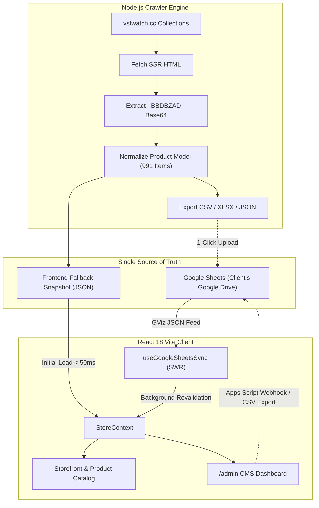

# Engineering Document: 991-Catalog Crawler, Google Sheets Real-time SSoT & Admin CMS

## 1. Technical Architecture

### Architecture Diagram

---

## 2. Component & Module Breakdown

### 2.1 Crawler Script (`scripts/crawl-catalog.mjs`)
- **Thuật toán**: Concurrency queue (10 workers song song) quét toàn bộ 991 URL sản phẩm từ `all_product_urls.json`.
- **Bóc tách Base64**: Regex bắt chuỗi `_BBDBZAD_` $\rightarrow$ `atob` $\rightarrow$ `decodeURIComponent` $\rightarrow$ trích xuất `product` object.
- **Chuẩn hóa trường**:
  - `id`: Slug sạch (ví dụ: `cw-rolex-submariner-126610ln`).
  - `brand`: Tự động phân loại thương hiệu dựa theo URL/title (Rolex, Omega, Patek Philippe, Audemars Piguet, Cartier, Hublot, Breitling, IWC, Panerai, Richard Mille,...).
  - `variants`:
    - `variant1`: Name = "Swiss Movement", Price = $Number.
    - `variant2`: Name = "VS / Clean 1:1 Super Clone", Price = $Number.
  - `images`: Mảng URL ảnh gốc CDN.
  - `specs`: Bóc tách thông số kỹ thuật (Movement, Case Size, Material, Water Resistance).
  - `body_html`: Nội dung mô tả gốc.
- **Xuất dữ liệu**: Ghi ra `src/data/crawled_watches.json` và `public/clonewatches_master_catalog.csv`.

### 2.2 Google Sheets Service (`src/services/googleSheetsService.js`)
- **GViz Query URL**:
  `https://docs.google.com/spreadsheets/d/${sheetId}/gviz/tq?tqx=out:json`
- **Parser**: Xử lý response JSON bọc bởi `/*O_o*/ google.visualization.Query.setResponse(...)`, parse bảng hàng & cột thành mảng JavaScript object có kiểu dữ liệu chuẩn xác.
- **Fail-safe Filter**: Tự động chuyển đổi chuỗi giá tiền `$700` hoặc `700 USD` về kiểu số nguyên `700`, xử lý giá trị rỗng hoặc định dạng sai để bảo đảm web không bao giờ bị lỗi.

### 2.3 StoreContext Integration (`src/context/StoreContext.jsx`)
- Mở rộng state:
  - `googleSheetId`: ID bảng tính của khách (lưu trong `localStorage`).
  - `syncStatus`: Trạng thái đồng bộ (`IDLE`, `SYNCING`, `SUCCESS`, `ERROR`).
  - `lastSyncTime`: Thời gian đồng bộ gần nhất.
  - `selectedVariant`: Biến thể người dùng đang chọn trên sản phẩm (`variant1` hoặc `variant2`).
  - `updateProduct`: Hàm cập nhật nhanh sản phẩm (hỗ trợ local edit & sync).
  - `exportToCsv`: Hàm tải file CSV danh mục về máy.
  - `importFromCsv`: Hàm nạp file CSV đã sửa vào hệ thống.

### 2.4 Admin CMS Portal (`src/components/admin/AdminDashboard.jsx`)
- Route component hiển thị khi URL là `#/admin` hoặc toggle chế độ Admin.
- **Giao diện**:
  - Màn hình Auth PIN code (`888888`).
  - Header: Thống kê số lượng sản phẩm, nút xem trang bán hàng, nút đăng xuất.
  - Bảng sản phẩm: Bộ lọc theo Brand, thanh tìm kiếm tức thì, phân trang 20 SP/trang.
  - Inline Edit: Nhấp đúp vào ô giá để sửa và tự động lưu.
  - Modal chi tiết: Chỉnh sửa 2 variants, thư viện ảnh kéo-thả, specs key-value builder, mô tả.
  - Tab Settings: Nhập Google Sheet ID, nút "Kiểm tra kết nối Real-time".
  - Nút Export / Import CSV.
