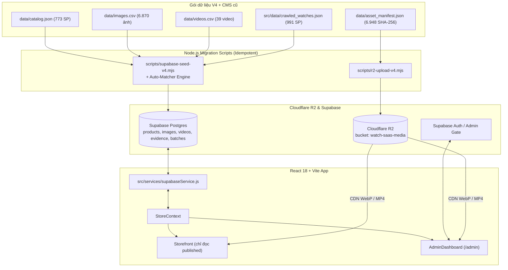

# Engineering Document: Catalog V4 Migration — Supabase Postgres + Cloudflare R2 Media Storage

## Metadata
- **Feature ID**: clonewatches-saas-3
- **Branch Name** (đề xuất): feature/clonewatches-saas-3_supabase-r2-catalog-v4
- **File Naming Convention**: clonewatches-saas-3_engineering_261121_v1.11.21.md
- **Created Date**: 2026-11-21 15:40
- **Last Updated**: 2026-11-21 15:40
- **Current Version**: v1.11.21
- **Author**: @Antigravity-Engineer
- **Status**: Approved
- **Approved By**: @user (2026-11-21)

---

## 1. Solution vs Codebase

### 1.1 Existing Behavior
- `src/data/crawled_watches.json` (12,9 MB, 991 items) được import trực tiếp vào `src/context/StoreContext.jsx`, khiến bundle nặng và mọi thay đổi phải build lại hoặc chỉ nằm ở `localStorage`.
- `src/services/googleSheetsService.js` fetch GViz JSON từ Google Sheets (đã chốt bỏ theo quyết định D3/D4 trong Master Doc).
- `src/components/admin/AdminDashboard.jsx` dùng PIN `888888` ở client và ghi trực tiếp vào `localStorage` (`cw_products_catalog`).
- `src/components/ProductCard.jsx`, `src/components/ProductQuickViewModal.jsx`, `src/components/product/ProductDetailPage.jsx` đang đọc cấu trúc phẳng của `crawled_watches.json` (`primaryImage`, chuỗi `galleryImages` phân tách bằng dấu phẩy, chưa có `nickname`, chưa hỗ trợ R2 relative path và video MP4 + poster).

### 1.2 Changes Required
| Area | File / Module | Action | Description |
|------|---------------|--------|-------------|
| Database DDL | `supabase/migrations/20261121000001_init_catalog_v4.sql` | Create | Toàn bộ bảng Postgres, indexes, triggers `updated_at`, RLS policies |
| Pipeline R2 | `scripts/r2-upload-v4.mjs` | Create | Upload 6.948 file (`assets/`) lên bucket `watch-saas-media` qua S3 API, đối chiếu `output_sha256` từ `asset_manifest.json`, resume/idempotent |
| Pipeline DB | `scripts/supabase-seed-v4.mjs` | Create | Nạp 773 Product V4, 6.870 ảnh, 39 video, aliases, nickname evidence; chạy thuật toán auto-match với 991 sản phẩm CMS cũ; nạp sản phẩm CMS cũ không khớp vào trạng thái `legacy = true` |
| Pipeline Verify | `scripts/verify-v4-migration.mjs` | Create | Kiểm tra số lượng DB, điều kiện BR-01..BR-19, sample HEAD request lên `R2_PUBLIC_URL` |
| Data Service | `src/services/supabaseService.js` | Create | Client Supabase REST/Auth nhẹ (hoặc `@supabase/supabase-js`), helper ghép URL R2 (`resolveMediaUrl`), CRUD sản phẩm, duyệt giá, bật/tắt xuất bản |
| State Context | `src/context/StoreContext.jsx` | Modify | Thay Google Sheets sync bằng Supabase fetch (`published` cho khách, full cho Admin), giữ fallback snapshot nhẹ khi offline |
| Admin UI | `src/components/admin/AdminDashboard.jsx` | Modify | Thêm bộ lọc Trạng thái xuất bản / Trạng thái giá (`auto_matched`, `confirmed`, `missing`) / Legacy; hàng đợi Rà soát giá; khoá nút Xuất bản khi chưa thoả BR-06; xem báo cáo lô import |
| Storefront UI | `src/components/ProductCard.jsx`, `ProductQuickViewModal.jsx`, `product/ProductDetailPage.jsx` | Modify | Hiển thị ảnh từ R2 CDN, badge `nickname` kèm tooltip miễn trừ (BR-08), gallery theo `position`, video player MP4 + poster (BR-04) |
| Styling Tokens | `src/index.css` | Modify | Bổ sung semantic tokens (`--color-success`, `--color-warning`, `--color-danger`, `--color-whatsapp`) theo Design System Audit |

### 1.3 Dependencies
- **Zero mandatory new runtime dependencies**: có thể gọi trực tiếp Supabase REST (`/rest/v1/*`) và Auth (`/auth/v1/*`) qua `fetch` chuẩn trong `src/services/supabaseService.js` với header `apikey: VITE_SUPABASE_ANON_KEY`, giữ `package.json` gọn nhẹ.
- **Scripts Node.js** (`scripts/*.mjs`): dùng `crypto`, `fs`, `https` built-in của Node >= 18 (AWS Signature V4 tự ký như đã test kết nối 200 OK), không bắt buộc cài `@aws-sdk/client-s3`.

---

## 2. Shared Section — Architecture, Security & Performance

### 2.1 Architecture Overview


### 2.2 Technical Decisions
1. **Đường dẫn media lưu tương đối trong DB (`assets/P000001/P000001-front-01.webp`)**:
   - *Lý do*: khớp 100% với `catalog.json`, `images.csv`, `videos.csv` và `asset_manifest.json`. Khi đổi từ `pub-xxx.r2.dev` sang custom domain `media.domain.com`, chỉ cần đổi 1 biến môi trường `VITE_R2_PUBLIC_URL`, không cần migration DB.
2. **Tự ký AWS SigV4 bằng Node `crypto` trong script upload R2**:
   - *Lý do*: tránh cài thêm hàng chục package `@aws-sdk/*`, chạy nhanh với concurrency pool (16–24 workers) và kiểm tra `x-amz-content-sha256` khớp `output_sha256` trong `asset_manifest.json`.
3. **Auto-Matching Engine chạy tại thời điểm seed (`D11`, `BR-10`, `BR-16..18`)**:
   - *Lý do*: người dùng đã chốt tự động nối giá/mô tả từ CMS cũ sang V4 và để Admin điều chỉnh sau. Thuật toán tính điểm tương đồng, gắn `price_status = 'auto_matched'` + `match_confidence` + `legacy_cms_id` khi đạt ngưỡng rõ ràng; nếu mơ hồ hoặc thấp thì để `price_status = 'missing'` để không bao giờ gắn nhầm giá tự động.

### 2.3 Security Considerations
- [x] **Không lộ secret**: `SUPABASE_SERVICE_ROLE_KEY`, `R2_ACCESS_KEY_ID`, `R2_SECRET_ACCESS_KEY` chỉ nằm trong `.env.local` (đã verify bị `.gitignore` chặn) và chỉ dùng bởi script Node.js ở máy local / server.
- [x] **Biến Frontend**: Frontend Vite chỉ đọc `VITE_SUPABASE_URL`, `VITE_SUPABASE_ANON_KEY` (publishable key) và `VITE_R2_PUBLIC_URL`.
- [x] **Row-Level Security (RLS)**:
  - Role `anon`: chỉ `SELECT` được các hàng trong `products` có `publication_status = 'published'` và `legacy = false`, cùng `product_images` / `product_videos` thuộc sản phẩm đã `published`; chỉ `INSERT` được vào `orders` / `order_items`.
  - Role `authenticated` (Admin) hoặc `service_role`: toàn quyền CRUD.
  - Bảng `nickname_evidence`, `import_batches`, `settings` (trừ key công khai như số WhatsApp): chặn `anon`.

### 2.4 Performance Implications
- **Giảm kích thước bundle Frontend**: Gỡ import trực tiếp 12,9 MB `crawled_watches.json` khỏi luồng khởi tạo chính hoặc thay bằng truy vấn phân trang/projection nhẹ từ Supabase, giảm thời gian parse JS ban đầu trên mobile.
- **Media Delivery**: Toàn bộ 6.870 ảnh V4 đã ở định dạng WebP sRGB quality 85 (max 2000px) và 39 video MP4 H.264 fast-start, phục vụ với header `Cache-Control: public, max-age=31536000, immutable`.
- **Database Indexes**: Đánh index trên `(publication_status, legacy, brand)`, `(price_status)`, `product_images(product_id, position)` giúp truy vấn danh mục < 50ms.

---

## 3. Backend Section — Database Schema, Matching Logic & Pipelines

### 3.1 Database Schema (Supabase Postgres DDL)

File: `supabase/migrations/20261121000001_init_catalog_v4.sql`

```sql
-- 1. Bảng products (SSoT cho cả 773 Product V4 và các SP Legacy từ CMS cũ)
CREATE TABLE IF NOT EXISTS public.products (
  product_id          TEXT PRIMARY KEY,                -- 'P000001' (V4) hoặc 'LEGACY-SPU-1003' (CMS cũ không khớp)
  family_id           TEXT,
  brand               TEXT NOT NULL DEFAULT '',
  collection          TEXT NOT NULL DEFAULT '',
  model               TEXT NOT NULL DEFAULT '',
  reference           TEXT NOT NULL DEFAULT '',
  title               TEXT NOT NULL,
  nickname            TEXT,                            -- BR-08: nhãn mô tả kiểu dáng
  dial_color          TEXT,
  case_finish         TEXT,
  bracelet_or_strap   TEXT,
  size_mm             TEXT,
  case_material       TEXT,
  media_readiness     TEXT NOT NULL DEFAULT 'web_ready',
  export_status       TEXT NOT NULL DEFAULT 'export_ready'
                      CHECK (export_status IN ('export_ready', 'held_for_review', 'insufficient_media')),
  publication_status  TEXT NOT NULL DEFAULT 'unpublished'
                      CHECK (publication_status IN ('unpublished', 'published')),
  hero_image          TEXT,                            -- relative path: 'assets/P000001/P000001-front-01.webp'
  image_count         INTEGER NOT NULL DEFAULT 0,
  video_count         INTEGER NOT NULL DEFAULT 0,

  -- Trường thương mại & thông số (kế thừa từ CMS cũ hoặc Admin nhập)
  spu                 TEXT,
  legacy_cms_id       TEXT,
  variant1_name       TEXT NOT NULL DEFAULT 'Swiss Movement',
  variant1_price      NUMERIC(12,2),
  variant2_name       TEXT NOT NULL DEFAULT 'VS / Clean 1:1 Super Clone',
  variant2_price      NUMERIC(12,2),
  price_status        TEXT NOT NULL DEFAULT 'missing'
                      CHECK (price_status IN ('missing', 'auto_matched', 'crawled', 'confirmed')),
  price_source        TEXT
                      CHECK (price_source IS NULL OR price_source IN ('admin', 'cms_legacy', 'crawl')),
  match_confidence    NUMERIC(4,3),                    -- 0.000 .. 1.000
  match_notes         TEXT,
  stock               TEXT NOT NULL DEFAULT 'IN_STOCK'
                      CHECK (stock IN ('IN_STOCK', 'OUT_OF_STOCK', 'PRE_ORDER')),
  movement            TEXT,
  water_resistance    TEXT,
  description_html    TEXT,
  data_sheet          JSONB NOT NULL DEFAULT '{}'::jsonb,
  qc_video_url        TEXT,
  legacy              BOOLEAN NOT NULL DEFAULT FALSE,  -- BR-11: SP CMS cũ ngoài V4 tạm ẩn

  created_at          TIMESTAMPTZ NOT NULL DEFAULT NOW(),
  updated_at          TIMESTAMPTZ NOT NULL DEFAULT NOW(),
  updated_by          TEXT
);

-- Ràng buộc BR-06/BR-07 ở tầng DB: không thể chuyển sang 'published' nếu thiếu điều kiện
ALTER TABLE public.products
  ADD CONSTRAINT products_publish_gate_chk CHECK (
    publication_status <> 'published'
    OR (
      legacy = FALSE
      AND export_status = 'export_ready'
      AND image_count >= 4
      AND btrim(brand) <> ''
      AND variant1_price IS NOT NULL AND variant1_price > 0
      AND price_status IN ('auto_matched', 'confirmed')
    )
  );

-- 2. Bảng product_images (6.870 dòng từ data/images.csv + asset_manifest.json)
CREATE TABLE IF NOT EXISTS public.product_images (
  image_id      TEXT PRIMARY KEY,                      -- 'I003601'
  product_id    TEXT NOT NULL REFERENCES public.products(product_id) ON DELETE CASCADE,
  role          TEXT NOT NULL,                         -- front, side, back, attachment, detail, angle, wrist
  position      INTEGER NOT NULL,                      -- 1..N (BR-03)
  src           TEXT NOT NULL,                         -- 'assets/P000001/P000001-front-01.webp'
  width         INTEGER,
  height        INTEGER,
  output_sha256 TEXT,
  output_bytes  INTEGER,
  created_at    TIMESTAMPTZ NOT NULL DEFAULT NOW()
);

-- 3. Bảng product_videos (39 dòng từ data/videos.csv — BR-04: poster không tính vào product_images)
CREATE TABLE IF NOT EXISTS public.product_videos (
  video_id      TEXT PRIMARY KEY,                      -- 'V000579'
  product_id    TEXT NOT NULL REFERENCES public.products(product_id) ON DELETE CASCADE,
  src           TEXT NOT NULL,                         -- 'assets/P000009/P000009-video-000579.mp4'
  poster        TEXT NOT NULL,                         -- 'assets/P000009/P000009-video-000579-poster.webp'
  width         INTEGER,
  height        INTEGER,
  duration      NUMERIC(10,5),
  video_sha256  TEXT,
  poster_sha256 TEXT,
  created_at    TIMESTAMPTZ NOT NULL DEFAULT NOW()
);

-- 4. Bảng product_aliases (20 cặp từ data/product_aliases.json)
CREATE TABLE IF NOT EXISTS public.product_aliases (
  alias_product_id     TEXT PRIMARY KEY,
  canonical_product_id TEXT NOT NULL REFERENCES public.products(product_id) ON DELETE CASCADE,
  created_at           TIMESTAMPTZ NOT NULL DEFAULT NOW()
);

-- 5. Bảng nickname_evidence (BR-09: chỉ Admin đọc, lưu từ review/nickname_evidence.csv & review_v4.csv)
CREATE TABLE IF NOT EXISTS public.nickname_evidence (
  id                  BIGSERIAL PRIMARY KEY,
  product_id          TEXT NOT NULL REFERENCES public.products(product_id) ON DELETE CASCADE,
  brand               TEXT,
  nickname            TEXT NOT NULL,
  label_basis         TEXT,                            -- 'named_design' | 'visual_style' | NULL
  evidence_image_ids  TEXT,
  visual_evidence     TEXT,
  comparison_url      TEXT,
  review_version      TEXT NOT NULL DEFAULT 'v4',
  created_at          TIMESTAMPTZ NOT NULL DEFAULT NOW()
);

-- 6. Bảng orders & order_items
CREATE TABLE IF NOT EXISTS public.orders (
  id              UUID PRIMARY KEY DEFAULT gen_random_uuid(),
  order_code      TEXT NOT NULL UNIQUE,
  customer_name   TEXT NOT NULL,
  customer_phone  TEXT NOT NULL,
  customer_email  TEXT,
  shipping_address TEXT,
  notes           TEXT,
  currency        TEXT NOT NULL DEFAULT 'USD',
  total_amount    NUMERIC(12,2) NOT NULL,
  status          TEXT NOT NULL DEFAULT 'PENDING_WHATSAPP',
  created_at      TIMESTAMPTZ NOT NULL DEFAULT NOW()
);

CREATE TABLE IF NOT EXISTS public.order_items (
  id            BIGSERIAL PRIMARY KEY,
  order_id      UUID NOT NULL REFERENCES public.orders(id) ON DELETE CASCADE,
  product_id    TEXT NOT NULL,
  title         TEXT NOT NULL,
  variant_name  TEXT NOT NULL,
  unit_price    NUMERIC(12,2) NOT NULL,
  quantity      INTEGER NOT NULL CHECK (quantity > 0)
);

-- 7. Bảng settings & import_batches
CREATE TABLE IF NOT EXISTS public.settings (
  key         TEXT PRIMARY KEY,
  value       JSONB NOT NULL,
  is_public   BOOLEAN NOT NULL DEFAULT FALSE,
  updated_at  TIMESTAMPTZ NOT NULL DEFAULT NOW()
);

CREATE TABLE IF NOT EXISTS public.import_batches (
  batch_id            TEXT PRIMARY KEY,
  source_name         TEXT NOT NULL,
  v4_products_count   INTEGER NOT NULL DEFAULT 0,
  images_count        INTEGER NOT NULL DEFAULT 0,
  videos_count        INTEGER NOT NULL DEFAULT 0,
  auto_matched_count  INTEGER NOT NULL DEFAULT 0,
  missing_price_count INTEGER NOT NULL DEFAULT 0,
  legacy_hidden_count INTEGER NOT NULL DEFAULT 0,
  r2_verified_files   INTEGER NOT NULL DEFAULT 0,
  report_json         JSONB NOT NULL DEFAULT '{}'::jsonb,
  created_at          TIMESTAMPTZ NOT NULL DEFAULT NOW()
);

-- Indexes
CREATE INDEX IF NOT EXISTS idx_products_pub_brand ON public.products(publication_status, legacy, brand);
CREATE INDEX IF NOT EXISTS idx_products_price_status ON public.products(price_status);
CREATE INDEX IF NOT EXISTS idx_product_images_prod_pos ON public.product_images(product_id, position);
CREATE INDEX IF NOT EXISTS idx_product_videos_prod ON public.product_videos(product_id);
```

#### RLS Policies
```sql
ALTER TABLE public.products ENABLE ROW LEVEL SECURITY;
ALTER TABLE public.product_images ENABLE ROW LEVEL SECURITY;
ALTER TABLE public.product_videos ENABLE ROW LEVEL SECURITY;
ALTER TABLE public.product_aliases ENABLE ROW LEVEL SECURITY;
ALTER TABLE public.nickname_evidence ENABLE ROW LEVEL SECURITY;
ALTER TABLE public.orders ENABLE ROW LEVEL SECURITY;
ALTER TABLE public.order_items ENABLE ROW LEVEL SECURITY;
ALTER TABLE public.settings ENABLE ROW LEVEL SECURITY;
ALTER TABLE public.import_batches ENABLE ROW LEVEL SECURITY;

-- Khách ẩn danh (anon) chỉ đọc được sản phẩm đã published & không phải legacy
CREATE POLICY "anon_read_published_products" ON public.products
  FOR SELECT TO anon
  USING (publication_status = 'published' AND legacy = FALSE);

CREATE POLICY "auth_all_products" ON public.products
  FOR ALL TO authenticated USING (TRUE) WITH CHECK (TRUE);

CREATE POLICY "anon_read_published_images" ON public.product_images
  FOR SELECT TO anon
  USING (EXISTS (
    SELECT 1 FROM public.products p
    WHERE p.product_id = product_images.product_id
      AND p.publication_status = 'published' AND p.legacy = FALSE
  ));

CREATE POLICY "auth_all_images" ON public.product_images
  FOR ALL TO authenticated USING (TRUE) WITH CHECK (TRUE);

CREATE POLICY "anon_read_published_videos" ON public.product_videos
  FOR SELECT TO anon
  USING (EXISTS (
    SELECT 1 FROM public.products p
    WHERE p.product_id = product_videos.product_id
      AND p.publication_status = 'published' AND p.legacy = FALSE
  ));

CREATE POLICY "auth_all_videos" ON public.product_videos
  FOR ALL TO authenticated USING (TRUE) WITH CHECK (TRUE);

-- Settings công khai (số WhatsApp, tiền tệ mặc định)
CREATE POLICY "anon_read_public_settings" ON public.settings
  FOR SELECT TO anon USING (is_public = TRUE);

CREATE POLICY "auth_all_settings" ON public.settings
  FOR ALL TO authenticated USING (TRUE) WITH CHECK (TRUE);

-- Khách được tạo đơn hàng mới
CREATE POLICY "anon_insert_orders" ON public.orders
  FOR INSERT TO anon WITH CHECK (TRUE);

CREATE POLICY "anon_insert_order_items" ON public.order_items
  FOR INSERT TO anon WITH CHECK (TRUE);

CREATE POLICY "auth_all_orders" ON public.orders
  FOR ALL TO authenticated USING (TRUE) WITH CHECK (TRUE);

CREATE POLICY "auth_all_order_items" ON public.order_items
  FOR ALL TO authenticated USING (TRUE) WITH CHECK (TRUE);

-- nickname_evidence và import_batches chỉ cho authenticated
CREATE POLICY "auth_all_evidence" ON public.nickname_evidence
  FOR ALL TO authenticated USING (TRUE) WITH CHECK (TRUE);

CREATE POLICY "auth_all_batches" ON public.import_batches
  FOR ALL TO authenticated USING (TRUE) WITH CHECK (TRUE);
```

### 3.2 Auto-Matching Business Logic (CMS cũ → Product V4)

Theo quyết định **D11** ("tự động duyệt và nối, Admin điều chỉnh sau") và **BR-10 / BR-16 / BR-17**:

1. **Chuẩn hóa token**:
   - Với mỗi Product V4 $P$ và sản phẩm CMS cũ $C$, chuẩn hóa chữ thường: `brand`, `collection`, `model`, `nickname`, `dial_color`, `size_mm`, `bracelet_or_strap`.
2. **Điều kiện lọc cứng**:
   - `norm(P.brand)` phải bằng `norm(C.brand)`. Nếu `P.brand` trống (15 Product V4), không tự khớp (`price_status = 'missing'`).
3. **Tính điểm tương đồng $S(P, C) \in [0, 1]$**:
   - Collection khớp trong `C.collection` hoặc `C.name`: $+0.35$
   - Model hoặc Nickname khớp trong `C.name`: $+0.35$
   - Dial color khớp trong `C.name` hoặc `C.description`: $+0.15$
   - Case size (`size_mm`) hoặc Bracelet/Strap khớp: $+0.15$
4. **Quy tắc quyết định nối tự động**:
   - Chọn các ứng viên $C$ có $S(P, C)$ cao nhất:
     - **Khớp rõ ràng (`auto_matched`)**: $S_{\max} \ge 0.70$, và tất cả ứng viên đạt $S_{\max}$ có **cùng cặp giá** `(variant1Price, variant2Price)` (hoặc chênh lệch $= 0$). Khi đó:
       - Gán `variant1_price`, `variant2_price`, `movement`, `water_resistance`, `description_html`, `data_sheet`, `legacy_cms_id = C.id`, `spu = C.spu`.
       - Gán `price_status = 'auto_matched'`, `price_source = 'cms_legacy'`, `match_confidence = S_max`.
     - **Khớp theo Brand + Collection đồng giá (`auto_matched` mức 2)**: Nếu $0.35 \le S_{\max} < 0.70$ nhưng toàn bộ sản phẩm cùng `(brand, collection)` trong CMS cũ có **một mức giá chuẩn duy nhất** (ví dụ đồng giá 700 / 1199 USD trong cùng bộ sưu tập), gán mức giá đó với `match_confidence = 0.65`, `match_notes = 'collection_uniform_price'`.
     - **Mơ hồ hoặc không khớp (`missing`)**: Để `variant1_price = NULL`, `variant2_price = NULL`, `price_status = 'missing'`, ghi rõ các ứng viên đang xung đột vào `match_notes` để Admin chọn bằng 1 cú nhấp trong màn **Rà soát giá**.
5. **Xử lý sản phẩm CMS cũ còn dư (`BR-11`)**:
   - Những sản phẩm trong 991 SP CMS cũ không thuộc gói V4 (Panerai, Breitling, Cartier, v.v.) được nạp với `product_id = 'LEGACY-' || spu`, `legacy = TRUE`, `publication_status = 'unpublished'` để giữ toàn vẹn dữ liệu 100% mà không hiển thị ra Storefront.

### 3.3 R2 Media Upload Pipeline (`scripts/r2-upload-v4.mjs`)
- Đọc `data/asset_manifest.json` (6.948 mục: 6.870 ảnh gallery + 39 video MP4 + 39 poster WebP).
- Với mỗi mục:
  1. Kiểm tra file cục bộ tồn tại và tính SHA-256 khớp `output_sha256`.
  2. Gửi `HEAD /{bucket}/{relative_path}` (hoặc dùng file state `.r2-upload-state.json` + liệt kê prefix `ListObjectsV2` ban đầu) để bỏ qua các file đã upload thành công có cùng `ETag` / kích thước `output_bytes` (Idempotent & Resume).
  3. Gửi `PUT /{bucket}/{relative_path}` với:
     - `Content-Type`: `image/webp` hoặc `video/mp4`
     - `Cache-Control`: `public, max-age=31536000, immutable`
     - `x-amz-content-sha256`: `output_sha256`
  4. Concurrency: 16 workers, tự động retry tối đa 3 lần với exponential backoff nếu gặp lỗi mạng/5xx.

---

## 4. Frontend Section — Services, Context & Components

### 4.1 `src/services/supabaseService.js` (NEW)
- **Hàm chính**:
  - `resolveMediaUrl(relativePath)`: Nếu `relativePath` bắt đầu bằng `assets/`, ghép `${VITE_R2_PUBLIC_URL}/${relativePath}`; nếu đã là `https://` thì giữ nguyên.
  - `fetchPublishedCatalog()`: Gọi Supabase REST lấy danh sách `products` (`publication_status=eq.published&legacy=eq.false`) kèm `product_images` (sắp theo `position` tăng dần) và `product_videos`, chuẩn hóa sang object tương thích ngược với Storefront (`primaryImage`, `images[]`, `videos[]`, `nickname`, `variant1Price`, `variant2Price`).
  - `fetchAdminCatalog(sessionToken)`: Lấy toàn bộ `products` (cả `unpublished`, `legacy`), `import_batches` mới nhất để hiển thị trên `/admin`.
  - `updateProductInDb(productId, patch, sessionToken)`: Cập nhật giá, brand, `price_status`, `publication_status` (kèm kiểm tra điều kiện BR-06 trước khi gửi).
  - `bulkUpdateProductsInDb(productIds, patch, sessionToken)`: Duyệt giá hoặc bật xuất bản hàng loạt.

### 4.2 `src/components/admin/AdminDashboard.jsx` (MODIFY)
- Thay cơ chế Google Sheets Settings bằng trạng thái kết nối **Supabase + Cloudflare R2** (hiển thị số Product V4, số ảnh trên R2, số SP đã khớp giá, số SP chờ duyệt giá).
- Thêm các tab / bộ lọc mới theo Wireframe ở Product Doc §6:
  - Bộ lọc **Trạng thái xuất bản**: `Tất cả | Đã xuất bản | Chưa xuất bản | Legacy (ẩn)`.
  - Bộ lọc **Trạng thái giá**: `Tất cả | Tự khớp (auto_matched) | Đã duyệt (confirmed) | Chưa có giá (missing)`.
  - Nút **Duyệt giá** (1-click chuyển `auto_matched` → `confirmed`) và **Xuất bản** (chỉ mở khi thoả BR-06: có brand, $\ge 4$ ảnh, giá $> 0$).
  - Hỗ trợ chọn nhiều dòng để **Duyệt giá hàng loạt** và **Xuất bản hàng loạt**.

### 4.3 Storefront Components (MODIFY)
- `ProductCard.jsx`, `ProductQuickViewModal.jsx`, `product/ProductDetailPage.jsx`:
  - Hiển thị badge `nickname` (ví dụ `"Pepsi"`, `"Spectre"`) kèm chú thích BR-08 (*"Tên gọi mô tả kiểu dáng, không xác nhận reference hay tính chính hãng"*).
  - Hiển thị gallery ảnh từ R2 theo đúng thứ tự `position` (ảnh `position = 1` là `hero_image`).
  - Nếu sản phẩm có bản ghi trong `product_videos`, hiển thị tab/khối Video QC phát file MP4 từ R2 với `poster` tương ứng (poster không trộn vào danh sách ảnh sản phẩm theo BR-04).

---

## 5. To-Do List

### Data & Infrastructure Layer
- [ ] **E1**: Tạo migration SQL `supabase/migrations/20261121000001_init_catalog_v4.sql` và áp dụng lên project Supabase `nuhgccxcwlrsbbcxpskn`.
- [ ] **E2**: Viết và chạy `scripts/r2-upload-v4.mjs` đẩy toàn bộ 6.948 file trong `assets/` lên Cloudflare R2 bucket `watch-saas-media`, kiểm tra SHA-256 khớp 100%.
- [ ] **E3**: Viết và chạy `scripts/supabase-seed-v4.mjs` nạp 773 Product V4, 6.870 ảnh, 39 video, 20 aliases, bằng chứng nickname, chạy Auto-Matcher với 991 sản phẩm CMS cũ và lưu báo cáo vào `import_batches`.
- [ ] **E4**: Cấu hình biến `VITE_SUPABASE_URL`, `VITE_SUPABASE_ANON_KEY`, `VITE_R2_PUBLIC_URL` trong `.env.local` (và `.env.example` không chứa secret).

### Frontend & Admin CMS
- [ ] **E5**: Xây dựng `src/services/supabaseService.js` và tích hợp vào `src/context/StoreContext.jsx` (loại bỏ Google Sheets sync, giữ fallback an toàn).
- [ ] **E6**: Nâng cấp `src/components/admin/AdminDashboard.jsx` với bộ lọc Xuất bản / Trạng thái giá / Legacy, hàng đợi Rà soát giá, hành động hàng loạt và kiểm tra khóa Xuất bản theo BR-06.
- [ ] **E7**: Cập nhật `ProductCard.jsx`, `ProductQuickViewModal.jsx`, `ProductDetailPage.jsx` hiển thị ảnh R2, nickname + miễn trừ BR-08, và video MP4 + poster.
- [ ] **E8**: Cập nhật semantic tokens trong `src/index.css` theo Design System Audit.

### Verification
- [ ] **E9**: Chạy `scripts/verify-v4-migration.mjs`, `npm run build` và kiểm thử trình duyệt headless theo QA Doc.

---

## 6. Related Documents
- **Master Doc**: `00-master/clonewatches-saas-3_master_261121_v1.11.21.md`
- **Product Doc**: `01-product/clonewatches-saas-3_product_261121_v1.11.21.md`
- **QA Doc**: `03-qa/clonewatches-saas-3_qa_261121_v1.11.21.md`
- **Tasks Doc**: `04-tasks/clonewatches-saas-3_tasks_261121_v1.11.21.md`

---

## 7. Changelog

| Version | Date | Time (HH:mm) | Author | Description | Reviewed By | Status |
|---------|------|--------------|--------|-------------|-------------|--------|
| v1.11.21 | 2026-11-21 | 15:40 | @Antigravity-Engineer | Khởi tạo Engineering Doc: kiến trúc Supabase + R2, DDL SQL + RLS, thuật toán Auto-Matching, R2 upload pipeline, thay đổi FE/Admin | @user | Approved |
